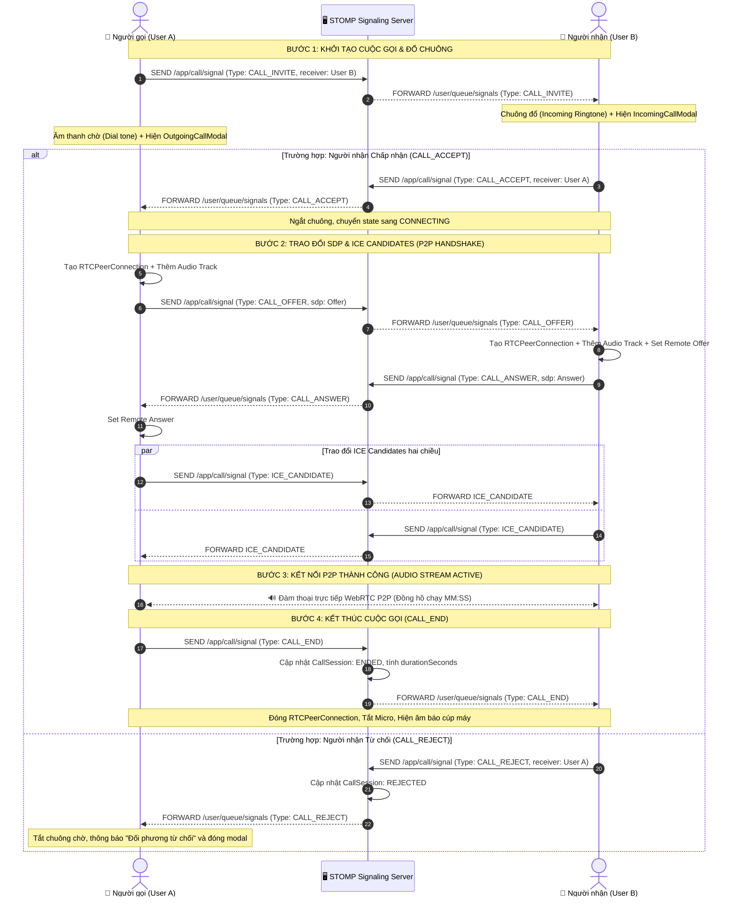
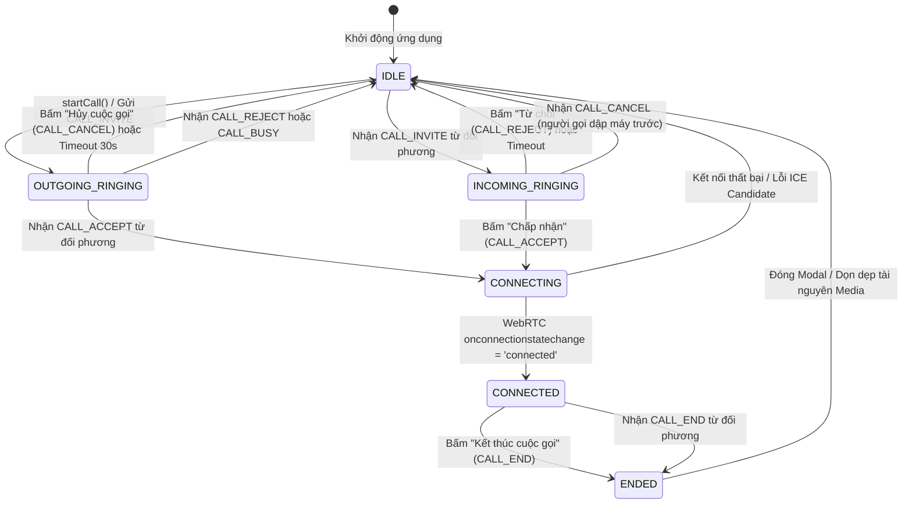

# KẾ HOẠCH CHI TIẾT TUẦN 2 (SPRINT 2) - TASK CHECKLIST
> **Dự án:** Ứng dụng Họp & Nhắn tin Trực tuyến (`promessagesapp` - Teams Clone)  
> **Thời gian thực hiện:** Tuần 2 (7 ngày)  
> **Quy mô đội ngũ:** 3 Thành viên (Fullstack theo phân hệ chức năng)  
> **Cách sử dụng tài liệu:** Các thành viên tích chọn `[x]` vào ô checkbox ngay sau khi hoàn thành công việc để báo cáo tiến độ hàng ngày (Daily Standup).

---

## 1. TỔNG QUAN TIẾN ĐỘ SPRINT 2

- [ ] **Tiến độ chung toàn đội:** `75%` (Phân hệ Nhắn tin 1-1 và Cuộc gọi thoại 1-1 WebRTC TV2 hoàn thành 100%)
- [x] **Mục tiêu 1:** Hệ thống Nhắn tin thời gian thực 1-1 (Direct Chat) hoàn chỉnh từ Backend đến Frontend (TV1) - **ĐÃ HOÀN THÀNH**
- [x] **Mục tiêu 2:** Thực hiện cuộc gọi thoại 1-1 WebRTC Audio P2P qua STOMP Signaling & Giao diện Gọi Teams (TV2) - **ĐÃ HOÀN THÀNH 100%**
- [ ] **Mục tiêu 3:** Studio Bảng vẽ Canvas cơ bản và kênh đồng bộ nét vẽ WebSocket (TV3)

---

## 2. CHECKLIST CHI TIẾT CHO THÀNH VIÊN 1 (AUTH, USER & CHAT CORE LEAD)
> **Nhánh Git:** `feature/w2-tv1-realtime-chat-1-1`  
> **Trọng tâm:** Xây dựng hệ thống nhắn tin 1-1 thời gian thực, lưu trữ lịch sử tin nhắn, kênh WebSocket STOMP và giao diện Chat Teams hoàn chỉnh.

### 📅 Ngày 1: Thiết kế Cơ sở dữ liệu Chat & Entity
- [x] **Sáng:** Tham gia họp Kick-off Sprint 2, chốt cấu trúc tin nhắn và giao thức `/topic/chat/{conversationId}`.
- [x] **Chiều:** Tạo Entity `Conversation.java` (id, name, type: `DIRECT | GROUP`, avatarUrl, lastMessageContent, lastMessageAt).
- [x] **Chiều:** Tạo Entity `ConversationMember.java` (conversationId, userId, role: `ADMIN | MEMBER`, joinedAt).
- [x] **Chiều:** Tạo Entity `Message.java` (conversationId, senderId, content, messageType: `TEXT | IMAGE | FILE | SYSTEM`, fileUrl).
- [x] **Chiều:** Tạo các Enum: `ConversationType.java`, `MessageType.java`, `MemberRole.java`.

### 📅 Ngày 2: Xây dựng Repositories & DTOs
- [x] **Sáng:** Tạo `ConversationRepository.java` với truy vấn lấy danh sách hội thoại theo `userId` và tìm direct chat giữa 2 user.
- [x] **Sáng:** Tạo `ConversationMemberRepository.java` kiểm tra thành viên và quyền hạn trong cuộc hội thoại.
- [x] **Sáng:** Tạo `MessageRepository.java` lấy lịch sử tin nhắn hỗ trợ phân trang (Pagination).
- [x] **Chiều:** Tạo các DTOs:
  - [x] `DirectConversationRequest.java` (Mở/tạo chat 1-1).
  - [x] `SendMessageRequest.java` (Gửi tin nhắn kèm validate nội dung).
  - [x] `MessageDto.java` (Đóng gói thông tin tin nhắn kèm tên và avatar người gửi).
  - [x] `ConversationDto.java` (Đóng gói thông tin hội thoại và đối phương).
  - [x] `ChatMessagePayload.java` (Khung bản tin truyền qua WebSocket).

### 📅 Ngày 3: Tầng Nghiệp vụ Service & REST APIs
- [x] **Sáng:** Xây dựng `ChatService.java` và `ChatServiceImpl.java`:
  - [x] `getUserConversations()`: Lấy danh sách cuộc trò chuyện kèm đối tác và tin nhắn cuối.
  - [x] `getOrCreateDirectConversation()`: Kiểm tra hoặc tự động tạo mới phòng chat 1-1 giữa 2 người.
  - [x] `getConversationMessages()` & `getAllMessagesAsc()`: Lấy lịch sử hội thoại.
  - [x] `saveMessage()`: Lưu tin nhắn và tự động cập nhật `lastMessageContent` cho phòng chat.
  - [x] `searchUsers()`: Tìm kiếm người dùng để bắt đầu nhắn tin mới.
- [x] **Chiều:** Tạo `ConversationController.java`:
  - [x] `GET /api/conversations`: Danh sách các cuộc trò chuyện.
  - [x] `POST /api/conversations/direct`: Mở phòng chat 1-1.
  - [x] `GET /api/conversations/{id}`: Chi tiết phòng chat.
  - [x] `GET /api/conversations/{id}/messages`: Lịch sử tin nhắn.
  - [x] `POST /api/conversations/{id}/messages`: Gửi tin nhắn qua REST API.
  - [x] `GET /api/users/search?q=...`: Tìm kiếm người dùng.

### 📅 Ngày 4: Kênh WebSocket STOMP Chat Thời gian thực
- [x] **Sáng:** Tạo `ChatWebSocketController.java` lắng nghe `@MessageMapping("/chat.sendMessage")`.
- [x] **Sáng:** Trích xuất Principal người dùng từ kết nối WebSocket STOMP.
- [x] **Chiều:** Lưu tin nhắn vào CSDL và broadcast tức thì tới `/topic/chat/{conversationId}` bằng `SimpMessagingTemplate`.
- [x] **Chiều:** Tích hợp đồng bộ broadcast cho cả hai kênh REST và WebSocket.

### 📅 Ngày 5: Frontend Chat Sidebar & Tìm kiếm người dùng
- [x] **Sáng:** Tạo `frontend/src/types/chat.ts` định nghĩa kiểu dữ liệu `Message`, `Conversation`.
- [x] **Sáng:** Tạo `frontend/src/services/chatService.ts` kết nối REST API.
- [x] **Chiều:** Xây dựng Component `ChatSidebar.tsx`:
  - [x] Danh sách các cuộc trò chuyện gần đây, hiển thị avatar và tin nhắn cuối.
  - [x] Chấm trạng thái Online/Offline theo thời gian thực.
  - [x] Nút "Bắt đầu cuộc trò chuyện mới" mở ô tìm kiếm người dùng.
  - [x] Bấm vào người dùng để khởi tạo chat 1-1 tức thì.

### 📅 Ngày 6: Khung Chat Chính (ChatWindow) & Đồng bộ WebSocket
- [x] **Sáng:** Xây dựng Component `ChatWindow.tsx`:
  - [x] Header phòng chat hiển thị tên, avatar và trạng thái người đang trò chuyện.
  - [x] Nút gọi thoại và gọi video (chuẩn bị kết nối với TV2).
  - [x] Bong bóng tin nhắn bên phải (của tôi) và bên trái (đối phương) chuẩn Teams.
  - [x] Tự động cuộn xuống đáy khi có tin nhắn mới (Smooth Auto-scroll).
  - [x] Ô nhập tin nhắn hỗ trợ gõ Enter để gửi.
- [x] **Chiều:** Xây dựng Hook `useChatWebSocket.ts`:
  - [x] Tự động subscribe kênh STOMP `/topic/chat/{conversationId}`.
  - [x] Nhận tin nhắn mới tức thì không cần tải lại trang.
- [x] **Chiều:** Hoàn thiện `ChatPage.tsx` và nhúng vào `App.tsx` thay thế placeholder cũ.

### 📅 Ngày 7: Unit Tests, Tinh chỉnh & Nghiệm thu
- [x] **Sáng:** Viết Unit Test `ChatServiceTest.java` (test tạo chat 1-1, lưu tin nhắn, lấy danh sách).
- [x] **Sáng:** Chạy `./mvnw test` đạt 100% PASS.
- [x] **Chiều:** Sẵn sàng nghiệm thu Sprint 2 cho phân hệ Nhắn tin 1-1.

---

## 3. CHECKLIST CHI TIẾT CHO THÀNH VIÊN 2 (CALLING & WEBRTC LEAD)
> **Nhánh Git:** `feature/w2-tv2-audio-call-1-1`  
> **Trọng tâm:** Xây dựng hoàn chỉnh luồng cuộc gọi thoại 1-1 (WebRTC Audio P2P) qua STOMP Signaling, xử lý các trạng thái cuộc gọi, âm thanh chuông gọi đến/đi, giao diện đàm thoại chuẩn Teams và lưu lịch sử cuộc gọi.

### 📅 Ngày 1: Hoàn thiện Giao thức Signaling STOMP & Nghiệp vụ Cuộc gọi Backend
- [x] **Sáng:** Tham gia họp Sprint 2, rà soát lại luồng bản tin Signaling WebRTC P2P qua kênh cá nhân `/user/{receiverId}/queue/signals`.
- [x] **Sáng:** Chuẩn hóa và mở rộng các loại tín hiệu trong `SignalType.java`:
  - [x] Thêm tín hiệu `CALL_CANCEL`: Người gọi chủ động cúp máy khi đầu bên kia chưa nghe máy.
  - [x] Thêm tín hiệu `CALL_BUSY`: Người nhận đang có một cuộc gọi khác đang diễn ra.
  - [x] Thêm tín hiệu `CALL_TIMEOUT`: Server hoặc Client tự động hủy sau 30 giây đổ chuông mà không ai trả lời.
- [x] **Chiều:** Nâng cấp `CallService.java`:
  - [x] Bổ sung method `isUserInCall(String userId)` kiểm tra người dùng có đang bận nghe máy không.
  - [x] Bổ sung method `cancelCall(String roomId)` cập nhật `CallStatus.CANCELLED`.
  - [x] Bổ sung method `timeoutCall(String roomId)` cập nhật `CallStatus.MISSED`.
  - [x] Hoàn thiện việc cập nhật thời lượng cuộc gọi (`durationSeconds`) chính xác khi kết thúc.
- [x] **Chiều:** Cập nhật `SignalingController.java`:
  - [x] Tiếp nhận và định tuyến các tín hiệu: `CALL_INVITE`, `CALL_ACCEPT`, `CALL_REJECT`, `CALL_CANCEL`, `CALL_OFFER`, `CALL_ANSWER`, `ICE_CANDIDATE`, `CALL_END`.
  - [x] Nếu `receiverId` đang bận, tự động gửi ngược tín hiệu `CALL_BUSY` về cho `senderId`.
  - [x] Ghi log chi tiết thông tin chuyển tiếp từng bản tin kèm `senderId`, `receiverId`, `roomId`.

### 📅 Ngày 2: Xây dựng Hạ tầng Frontend Signaling & WebRTC Client Core
- [x] **Sáng:** Tạo file định nghĩa types `frontend/src/types/calling.ts`:
  - [x] Enum `SignalType` khớp 100% với Backend (`CALL_INVITE`, `CALL_ACCEPT`, `CALL_REJECT`, `CALL_CANCEL`, `CALL_OFFER`, `CALL_ANSWER`, `ICE_CANDIDATE`, `CALL_END`, `CALL_BUSY`).
  - [x] Enum `CallStatus`: `IDLE` | `OUTGOING_RINGING` | `INCOMING_RINGING` | `CONNECTING` | `CONNECTED` | `ENDED`.
  - [x] Interface `SignalMessage` (type, senderId, senderName, receiverId, roomId, payload, timestamp).
  - [x] Interface `CallParticipantInfo` (id, name, avatarUrl, isMuted).
- [x] **Sáng:** Xây dựng `frontend/src/services/signalingService.ts`:
  - [x] Lắng nghe tin nhắn từ STOMP topic `/user/queue/signals`.
  - [x] Viết hàm `sendSignal(signal: SignalMessage)` gửi tới `/app/call/signal`.
  - [x] Cơ chế quản lý danh sách callback (`subscribeToSignals`, `unsubscribeFromSignals`).
- [x] **Chiều:** Xây dựng Lõi kết nối WebRTC `frontend/src/services/webrtcManager.ts`:
  - [x] Cấu hình ICE Servers công khai: Google STUN (`stun:stun.l.google.com:19302`, `stun:stun1.l.google.com:19302`).
  - [x] Khởi tạo đối tượng `RTCPeerConnection` chuyên biệt cho chế độ Audio.
  - [x] Viết hàm `createOffer()`: Thêm audio track nội bộ, tạo SDP Offer, gán `setLocalDescription` và trả về SDP.
  - [x] Viết hàm `handleOfferAndCreateAnswer(sdp)`: Nhận SDP Offer từ đối phương, gán `setRemoteDescription`, tạo SDP Answer, gán `setLocalDescription` và trả về SDP Answer.
  - [x] Viết hàm `handleAnswer(sdp)`: Nhận SDP Answer và gán `setRemoteDescription`.
  - [x] Viết hàm `addIceCandidate(candidate)`: Nạp các ICE Candidate nhận được từ đối phương.
  - [x] Xử lý sự kiện `onicecandidate`: Tự động bắn bản tin `ICE_CANDIDATE` qua `signalingService`.
  - [x] Xử lý sự kiện `ontrack`: Lấy remote audio stream và gán tự động vào thẻ `<audio autoPlay />`.

### 📅 Ngày 3: Custom Hooks Quản lý Micro & Máy Trạng Thái Cuộc Gọi (`useAudioCall`)
- [x] **Sáng:** Xây dựng Custom Hook `frontend/src/hooks/useMediaStream.ts`:
  - [x] Yêu cầu quyền truy cập micro từ trình duyệt: `navigator.mediaDevices.getUserMedia({ audio: true, video: false })`.
  - [x] Quản lý trạng thái: `localStream`, `isMuted`, `permissionError`.
  - [x] Viết hàm `toggleMute()`: Đảo trạng thái `audioTrack.enabled = !audioTrack.enabled`.
  - [x] Viết hàm `stopStream()`: Duyệt qua tất cả track và gọi `track.stop()` để tắt hoàn toàn đèn mic trên trình duyệt.
  - [x] Bắt lỗi thiết bị: Người dùng từ chối cấp quyền (`NotAllowedError`), không tìm thấy micro (`NotFoundError`).
- [x] **Chiều:** Xây dựng Custom Hook trung tâm `frontend/src/hooks/useAudioCall.ts`:
  - [x] Quản lý toàn bộ State máy trạng thái cuộc gọi:
    - `callStatus`: Trạng thái cuộc gọi hiện tại.
    - `currentRoomId`: ID phòng gọi chung giữa 2 người.
    - `caller`: Thông tin người gọi đến (nếu có cuộc gọi đến).
    - `targetUser`: Thông tin người được gọi (khi thực hiện gọi đi).
    - `duration`: Số giây đàm thoại thực tế.
    - `isMuted`: Trạng thái bật/tắt micro.
  - [x] Cài đặt Action `startCall(targetUserId, targetUserName)`:
    - Xin quyền micro -> Lấy local stream -> Gửi `CALL_INVITE` -> Đổi state sang `OUTGOING_RINGING`.
    - Thiết lập bộ đếm 30 giây tự động hủy nếu đối phương không nghe máy.
  - [x] Cài đặt Action `acceptCall()`:
    - Xin quyền micro -> Gửi `CALL_ACCEPT` -> Chuyển state sang `CONNECTING` -> Khởi tạo WebRTC Handshake (tạo Offer/Answer).
  - [x] Cài đặt Action `rejectCall()`:
    - Gửi `CALL_REJECT` -> Dọn dẹp WebRTC -> Chuyển state về `IDLE`.
  - [x] Cài đặt Action `cancelCall()`:
    - Khi đang chuông gọi đi, bấm cúp máy -> Gửi `CALL_CANCEL` -> Reset state về `IDLE`.
  - [x] Cài đặt Action `endCall()`:
    - Khi đang đàm thoại, bấm cúp máy -> Gửi `CALL_END` -> Đóng `RTCPeerConnection` -> Tắt mic -> Dừng timer -> Reset state.
  - [x] Xây dựng bộ đếm thời gian đàm thoại (Duration Timer): Chạy `setInterval` tăng `duration` mỗi giây khi `callStatus === 'CONNECTED'`.

### 📅 Ngày 4: Hiệu ứng Âm thanh Chuông & Giao diện Modal Cuộc gọi Đến (Incoming Call)
- **Sáng:** Xây dựng tiện ích âm thanh `frontend/src/utils/callSounds.ts`:
  - [x] Tạo âm thanh nhạc chuông cuộc gọi đến (Incoming Ringtone) bằng Web Audio API Synthesis hoặc Audio File phát lặp liên tục (`loop = true`).
  - [x] Tạo âm thanh chuông chờ đầu dây bên kia nhấc máy (Outgoing Ringback Tone - tiếng tút tút dài chu kỳ 3 giây).
  - [x] Tạo âm thanh báo bận hoặc dập máy (End Call Tone - 3 tiếng bíp ngắn dứt khoát).
  - [x] Các hàm điều khiển: `playIncomingRingtone()`, `playDialTone()`, `playEndTone()`, `stopAllSounds()`.
  - [x] Đảm bảo tự động tắt tiếng chuông ngay khi bấm Chấp nhận, Từ chối hoặc cuộc gọi bị hủy.
- **Chiều:** Xây dựng Component `IncomingCallModal.tsx`:
  - [x] Giao diện Modal nổi bật phong cách Microsoft Teams Dark Theme (`bg-[#201f1f]`, border tím nhạt).
  - [x] Avatar người gọi kích thước lớn kèm hiệu ứng vòng tròn sóng rung động (Pulse Ring Animation).
  - [x] Hiển thị tên hiển thị người gọi, email và dòng thông báo *"Cuộc gọi thoại Teams đến..."*.
  - [x] 2 nút bấm thao tác trực quan:
    - [x] Nút **"Trả lời"** màu xanh lục (`bg-emerald-600 hover:bg-emerald-500`) kèm icon `PhoneCall`.
    - [x] Nút **"Từ chối"** màu đỏ (`bg-rose-600 hover:bg-rose-500`) kèm icon `PhoneOff`.
  - [x] Tự động đóng modal và phát âm thanh kết thúc nếu nhận được tín hiệu `CALL_CANCEL` từ người gọi.

### 📅 Ngày 5: Giao diện Đàm thoại Active Call & Tích hợp Khung Chat 1-1
- **Sáng:** Xây dựng Component `ActiveCallModal.tsx` & `OutgoingCallModal.tsx`:
  - [x] Khi đang gọi đi (`OUTGOING_RINGING`):
    - [x] Hiển thị Avatar đối phương, tên và dòng trạng thái nhấp nháy *"Đang đổ chuông..."*.
    - [x] Nút tròn màu đỏ ở giữa: "Hủy cuộc gọi" (`cancelCall`).
  - [x] Khi đang đàm thoại (`CONNECTED`):
    - [x] Avatar đối phương ở vị trí trung tâm, có viền phát sáng xanh/tím (Active Speaker Glow) khi có âm thanh micro.
    - [x] Đồng hồ đếm thời gian gọi định dạng phút:giây (`MM:SS`, ví dụ: `03:42`).
    - [x] Nút **Bật/Tắt Micro (Mute)**: Icon `Mic` (nền tối khi bật) / `MicOff` (nền đỏ khi tắt).
    - [x] Nút **Thu nhỏ cuộc gọi (Minimize)**: Cho phép thu nhỏ cuộc gọi thành thanh nổi (Floating Call Pill) ở góc dưới màn hình để người dùng có thể vừa nghe gọi vừa nhắn tin chat.
    - [x] Nút **Kết thúc cuộc gọi (End Call)**: Nút tròn đỏ lớn ở giữa kèm icon `PhoneOff`.
- **Chiều:** Tích hợp trực tiếp vào Component `ChatWindow.tsx`:
  - [x] Gắn sự kiện `onClick` cho nút gọi thoại `<button title="Bắt đầu cuộc gọi thoại (WebRTC Audio)">` ở header chat.
  - [x] Khi bấm nút: Kiểm tra nếu đối phương đang online thì gọi `startCall(conversation.otherUser.id, conversation.otherUser.displayName)`.
  - [x] Hiển thị thông báo nếu đối phương đang offline hoặc nếu chính mình đang trong cuộc gọi khác.
  - [x] Đặt `IncomingCallModal` và `ActiveCallModal` tại root layout (`TeamsLayout`) để cuộc gọi hoạt động xuyên suốt toàn bộ ứng dụng.

### 📅 Ngày 6: Xây dựng Trang Lịch sử Cuộc gọi (CallsPage) & REST API Call Logs
- **Sáng:** Cải tiến và bổ sung REST API Call History bên Backend:
  - [x] Viết DTO `CallLogDto.java`: `id`, `roomId`, `callerId`, `callerName`, `callerAvatar`, `receiverId`, `receiverName`, `receiverAvatar`, `callType`, `status`, `startedAt`, `durationSeconds`.
  - [x] Cải tiến Query trong `CallSessionRepository.java` sắp xếp các cuộc gọi theo `createdAt DESC`.
  - [x] Endpoint `GET /api/call/history/{userId}` trả về danh sách lịch sử cuộc gọi đầy đủ.
  - [x] Endpoint `GET /api/call/active-session` kiểm tra nhanh xem người dùng hiện tại có phiên gọi dở dang nào không.
- **Chiều:** Xây dựng Component `CallsPage.tsx` thay thế placeholder cũ trong `App.tsx`:
  - [x] Thanh Sidebar bộ lọc cuộc gọi: "Tất cả cuộc gọi", "Cuộc gọi nhỡ", "Cuộc gọi đến", "Cuộc gọi đi".
  - [x] Danh sách lịch sử cuộc gọi hiển thị đẹp mắt phong cách Teams:
    - [x] Icon trạng thái: Mũi tên xanh lá chỉ xuống (Cuộc gọi đến), Mũi tên xanh dương chỉ lên (Cuộc gọi đi), Mũi tên đỏ gạch chéo (Cuộc gọi nhỡ).
    - [x] Tên người liên hệ, avatar và thời gian diễn ra cuộc gọi (ví dụ: *Hôm nay, 14:20*).
    - [x] Thời lượng cuộc gọi (ví dụ: *05 phút 12 giây* hoặc *Nhỡ*).
    - [x] Nút "Gọi lại" (Quick Call button) bên cạnh mỗi dòng lịch sử để bấm gọi thoại ngay lập tức.
  - [x] Hiển thị Empty State thân thiện khi danh sách cuộc gọi trống.

### 📅 Ngày 7: Unit Tests, Tích hợp Toàn diện, Test Cuộc gọi 2 Trình duyệt & Demo
- **Sáng:** Viết Unit Tests & Integration Tests:
  - [x] Viết `CallServiceTest.java`:
    - [x] Test khởi tạo cuộc gọi mới (`initiateCall`) sinh đúng `CallSession` và `CallParticipant`.
    - [x] Test chấp nhận cuộc gọi (`acceptCall`) cập nhật trạng thái `CONNECTED` và lưu `startedAt`.
    - [x] Test từ chối cuộc gọi (`rejectCall`) cập nhật trạng thái `REJECTED`.
    - [x] Test kết thúc cuộc gọi (`endCall`) tính toán đúng số giây chênh lệch `durationSeconds`.
  - [x] Viết `SignalingControllerTest.java`:
    - [x] Test endpoint `/app/ping` nhận phản hồi PONG.
    - [x] Test định tuyến bản tin `/app/call/signal` tới đúng user queue qua `SimpMessagingTemplate`.
  - [x] Chạy `./mvnw clean test` đạt 100% PASS.
- **Chiều:** Kiểm thử liên thông thực tế (End-to-End Cross Testing):
  - [x] Mở 2 trình duyệt riêng biệt (Chrome thường & Edge hoặc Chrome Ẩn danh).
  - [x] Đăng nhập 2 tài khoản: User A (`user1@gmail.com`) và User B (`user2@gmail.com`).
  - [x] Kịch bản 1 (Cuộc gọi thành công):
    - [x] User A bấm nút Gọi thoại cho User B từ khung chat.
    - [x] User A thấy giao diện "Đang đổ chuông..." và nghe tiếng dial tone.
    - [x] User B xuất hiện modal cuộc gọi đến, chuông rung reo -> Bấm nút "Trả lời".
    - [x] Cả 2 modal chuyển sang "Đang đàm thoại", đồng hồ thời lượng bắt đầu đếm `00:01`, `00:02`...
    - [x] Kiểm tra âm thanh micro truyền qua lại rõ ràng, không bị vọng hay méo tiếng.
    - [x] Thử nghiệm bấm nút Mute mic ở tab A -> Tab B không còn nghe tiếng tab A.
    - [x] Bấm nút "Kết thúc cuộc gọi" -> Cả 2 modal đóng lại, âm báo dập máy vang lên.
    - [x] Vào trang "Cuộc gọi" kiểm tra: Dòng lịch sử cuộc gọi hiển thị chính xác thời lượng đàm thoại.
  - [x] Kịch bản 2 (Từ chối cuộc gọi): User A gọi -> User B bấm "Từ chối" -> User A nhận thông báo đối phương từ chối và tự đóng modal.
  - [x] Kịch bản 3 (Hủy cuộc gọi trước khi bắt máy): User A gọi -> Bấm "Hủy cuộc gọi" trước khi User B trả lời -> User B tự tắt modal chuông đến.
  - [x] Hoàn thiện Pull Request `feature/w2-tv2-audio-call-1-1` vào nhánh `develop`, chuẩn bị cho Sprint Review.

---

## 4. CHECKLIST CHI TIẾT CHO THÀNH VIÊN 3 (WHITEBOARD & AI LEAD)
> **Nhánh Git:** `feature/w2-tv3-canvas-studio`  
> **Trọng tâm:** Tích hợp bộ công cụ vẽ Canvas Studio cơ bản (HTML5 Canvas / Fabric.js), xây dựng thanh công cụ vẽ, Entity WhiteboardSession và kênh đồng bộ nét vẽ WebSocket cơ bản.

### 📅 Ngày 1: Nghiên cứu Canvas Engine & Khởi tạo Studio
- [ ] **Sáng:** Lựa chọn và cài đặt thư viện Canvas: `fabric` hoặc HTML5 Canvas API thuần trên React.
- [ ] **Sáng:** Thiết kế Component khung vẽ `WhiteboardCanvas.tsx`: Tự động co giãn theo kích thước vùng làm việc màn hình (Auto-resize Responsive).
- [ ] **Chiều:** Cài đặt cơ chế bắt sự kiện chuột trên Canvas: `onMouseDown`, `onMouseMove`, `onMouseUp` để ghi nhận tọa độ điểm vẽ.
- [ ] **Chiều:** Thiết kế thanh công cụ vẽ (Drawing Toolbar) cố định ở cạnh trên hoặc cạnh trái khung vẽ.

### 📅 Ngày 2: Công cụ Bút vẽ Tự do (Pencil / Freehand) & Bảng Màu
- [ ] **Sáng:** Xây dựng công cụ Bút vẽ tự do (Pencil tool):
  - [ ] Vẽ đường cong mượt mà theo tọa độ di chuột của người dùng.
  - [ ] Quản lý độ mượt nét vẽ (Path Smoothing / Quadratic curve).
- [ ] **Chiều:** Xây dựng Bảng chọn màu sắc (Color Palette) chuẩn phong cách Microsoft:
  - [ ] Bảng màu nhanh: Đen, Trắng, Tím Teams (`#5B5FC7`), Đỏ (`#C4314B`), Xanh lá (`#107C41`), Xanh dương (`#0078D4`), Vàng (`#FFB900`).
  - [ ] Thanh trượt điều chỉnh độ dày nét vẽ (Stroke Width: 2px, 4px, 8px, 12px, 20px).

### 📅 Ngày 3: Công cụ Tẩy (Eraser) & Xóa toàn bộ Bảng (Clear Board)
- [ ] **Sáng:** Xây dựng công cụ Tẩy (Eraser Tool):
  - [ ] Tẩy nét vẽ theo chế độ xóa vật thể (Object Eraser) hoặc tẩy điểm ảnh (Pixel Eraser).
  - [ ] Con trỏ chuột đổi sang hình tròn biểu thị kích thước đầu tẩy.
- [ ] **Chiều:** Xây dựng chức năng Xóa sạch bảng vẽ (Clear Canvas):
  - [ ] Nút "Xóa toàn bộ" trên thanh công cụ.
  - [ ] Hộp thoại Modal xác nhận *"Bạn có chắc chắn muốn xóa toàn bộ nội dung bảng vẽ không?"*.
  - [ ] Hỗ trợ phím tắt hoàn tác nhanh (`Ctrl + Z` - Undo cơ bản).

### 📅 Ngày 4: Bổ sung Công cụ Hình học & Khung chữ (Text Box)
- [ ] **Sáng:** Xây dựng công cụ vẽ Hình học cơ bản:
  - [ ] Công cụ vẽ Hình chữ nhật (Rectangle).
  - [ ] Công cụ vẽ Hình tròn / Elip (Circle / Ellipse).
  - [ ] Công cụ vẽ Đường thẳng (Line) và Mũi tên (Arrow).
- [ ] **Chiều:** Xây dựng công cụ Hộp văn bản (Text Box):
  - [ ] Click đúp chuột vào vị trí bất kỳ trên bảng để gõ chữ.
  - [ ] Hỗ trợ chọn cỡ chữ, đổi màu chữ và di chuyển vị trí hộp chữ.

### 📅 Ngày 5: Backend WebSocket Whiteboard & Lưu trữ Phiên vẽ
- [ ] **Sáng:** Tạo Entity `WhiteboardSession.java` (id, conversationId, title, canvasDataJson, createdAt, updatedAt).
- [ ] **Sáng:** Tạo `WhiteboardRepository.java` lưu trữ và truy vấn bảng vẽ theo `conversationId`.
- [ ] **Chiều:** Cấu hình kênh WebSocket STOMP cho Whiteboard:
  - [ ] Endpoint lắng nghe: `@MessageMapping("/whiteboard/{sessionId}/draw")`.
  - [ ] Endpoint broadcast: `/topic/whiteboard/{sessionId}` phát lại nét vẽ cho mọi người cùng xem.
- [ ] **Chiều:** Tạo REST Controller `WhiteboardController.java` lưu snapshot dữ liệu bảng vẽ định dạng JSON (`POST /api/whiteboard/{id}/snapshot`).

### 📅 Ngày 6: Tích hợp Đồng bộ Nét vẽ Hai chiều giữa Frontend & Backend
- [ ] **Sáng:** Tạo custom hook `frontend/src/hooks/useWhiteboardWebSocket.ts`:
  - [ ] Tự động kết nối và subscribe kênh `/topic/whiteboard/{sessionId}`.
  - [ ] Nhận dữ liệu nét vẽ từ xa và render tự động lên Canvas của người dùng.
- [ ] **Chiều:** Bổ sung cơ chế giảm tải băng thông (Throttling / Debouncing):
  - [ ] Gom cụm các điểm tọa độ chuột trước khi bắn qua WebSocket (tránh gửi hàng trăm request/giây làm nghẽn mạng).
  - [ ] Xử lý không bị giật lag khi 2 người cùng vẽ đồng thời.

### 📅 Ngày 7: Hoàn thiện Trang WhiteboardPage, Unit Tests & Nghiệm thu
- [ ] **Sáng:** Hoàn thiện giao diện `WhiteboardPage.tsx` nhúng vào router chính của ứng dụng.
- [ ] **Sáng:** Bổ sung nút Xuất ảnh bảng vẽ ra file PNG (`canvas.toDataURL('image/png')`).
- [ ] **Chiều:** Viết Unit Test cho Whiteboard Controller & Service.
- [ ] **Chiều:** Thử nghiệm vẽ trên 2 trình duyệt đồng thời, xác nhận nét vẽ hiển thị đồng bộ mượt mà.
- [ ] **Chiều:** Hoàn thiện Pull Request `feature/w2-tv3-canvas-studio` vào nhánh `develop`.

---

## 5. BẢNG CHECKLIST WBS THEO ĐẦU VIỆC (DEFINITION OF DONE)

| Trạng thái | Mã Task | Người phụ trách | Tên công việc chi tiết | Ước lượng | Tiêu chuẩn Hoàn thành (DoD) |
| :---: | :--- | :---: | :--- | :---: | :--- |
| [x] | **W2-TV1-01** | **TV1** | Entity Conversation, Member & Message | 6h | Sinh đúng bảng `conversations`, `conversation_members`, `messages` trong PostgreSQL. |
| [x] | **W2-TV1-02** | **TV1** | Repositories & DTOs Chat | 6h | Truy vấn hội thoại theo user, kiểm tra quyền xem tin nhắn; DTOs chuẩn format. |
| [x] | **W2-TV1-03** | **TV1** | Service & REST APIs Chat 1-1 | 8h | API tạo direct chat, lấy lịch sử tin nhắn, tìm kiếm người dùng 200 OK. |
| [x] | **W2-TV1-04** | **TV1** | STOMP Controller `/topic/chat/{id}` | 6h | Nhận tin nhắn từ client, lưu DB và broadcast tức thì tới mọi người trong phòng. |
| [x] | **W2-TV1-05** | **TV1** | Giao diện Chat Sidebar & Tìm kiếm | 8h | Danh sách hội thoại đẹp, preview tin nhắn cuối, tìm kiếm người dùng để chat mượt mà. |
| [x] | **W2-TV1-06** | **TV1** | Giao diện ChatWindow & STOMP Client | 8h | Bong bóng chat chuẩn màu Teams, gõ Enter gửi tin, auto-scroll, realtime qua WebSocket. |
| [x] | **W2-TV1-07** | **TV1** | Unit Tests ChatService & Review | 6h | Test cases bao quát đủ logic nghiệp vụ, `./mvnw test` xanh 100%. |
| [x] | **W2-TV2-01** | **TV2** | Chuẩn hóa Giao thức STOMP Signaling & CallService | 8h | Bổ sung `CALL_CANCEL`, `CALL_BUSY`, `CALL_TIMEOUT`; lưu DB trạng thái và thời lượng gọi chính xác. |
| [x] | **W2-TV2-02** | **TV2** | Module WebRtcManager & SignalingService Frontend | 8h | Xử lý RTCPeerConnection audio-only, ICE Candidate, SDP Offer/Answer qua STOMP `/user/queue/signals`. |
| [x] | **W2-TV2-03** | **TV2** | Hook `useMediaStream` & `useAudioCall` | 8h | Quản lý vòng đời mic, state machine (`IDLE` -> `RINGING` -> `CONNECTED`), bộ đếm thời gian gọi. |
| [x] | **W2-TV2-04** | **TV2** | Hệ thống Chuông & Component IncomingCallModal | 6h | Chuông reo gọi đến/đi mượt mà, modal Teams đẹp mắt, nút Trả lời / Từ chối hoạt động nhạy. |
| [x] | **W2-TV2-05** | **TV2** | Component ActiveCallModal & Nút Gọi Khung Chat | 8h | Giao diện đàm thoại hiển thị thời lượng, nút Mute mic, thu nhỏ nổi, gắn nút gọi vào ChatWindow. |
| [x] | **W2-TV2-06** | **TV2** | REST API Call Logs & Giao diện CallsPage | 6h | API lịch sử cuộc gọi hoạt động; trang Calls hiển thị đầy đủ cuộc gọi đến/đi/nhỡ kèm thời lượng. |
| [x] | **W2-TV2-07** | **TV2** | Unit Tests Backend & Test Cuộc gọi E2E 2 Browser | 6h | `./mvnw test` đạt 100% PASS; gọi thoại nói nghe rõ giữa 2 tab trình duyệt thực tế. |
| [ ] | **W2-TV3-01** | **TV3** | Khởi tạo Whiteboard Canvas & Toolbar Cơ bản | 6h | Canvas hiển thị sắc nét, responsive theo màn hình, bắt sự kiện chuột mượt mà. |
| [ ] | **W2-TV3-02** | **TV3** | Công cụ Bút vẽ Tự do & Bảng màu Teams | 6h | Nét vẽ mượt không đứt gãy, đổi màu sắc và độ dày nét vẽ linh hoạt. |
| [ ] | **W2-TV3-03** | **TV3** | Công cụ Tẩy nét vẽ & Xóa toàn bộ Canvas | 6h | Tẩy nét vẽ sạch sẽ, nút Clear Canvas có modal xác nhận, hỗ trợ phím tắt hoàn tác. |
| [ ] | **W2-TV3-04** | **TV3** | Công cụ Hình học (Hộp, Tròn, Mũi tên) & Text | 8h | Kéo thả tạo hình khối chuẩn xác; click đúp chèn văn bản trên canvas. |
| [ ] | **W2-TV3-05** | **TV3** | Entity WhiteboardSession & WebSocket Broker | 6h | Lưu dữ liệu nét vẽ vào CSDL; endpoint `/topic/whiteboard/{id}` broadcast ổn định. |
| [ ] | **W2-TV3-06** | **TV3** | Đồng bộ Nét vẽ Hai chiều & Giảm tải Băng thông | 8h | Áp dụng Throttling, nhiều tab vẽ cùng lúc không bị gián đoạn hay trễ mạng. |
| [ ] | **W2-TV3-07** | **TV3** | Trang WhiteboardPage, Xuất ảnh PNG & Tests | 6h | Xuất ảnh canvas ra PNG thành công; test controller backend đạt chuẩn. |

---

## 6. SƠ ĐỒ TUẦN TỰ BẢN TIN SIGNALING & THIẾT LẬP CUỘC GỌI WEBRTC AUDIO 1-1

---

## 7. MÁY TRẠNG THÁI CUỘC GỌI PHÍA CLIENT (CALL STATE MACHINE)

---

## 8. CHECKLIST NGHIỆM THU CUỐI TUẦN 2 (SPRINT REVIEW GO / NO-GO)
> **Thời gian đánh giá:** Chiều Thứ 7 (Ngày 7)  
> **Điều kiện Release Sprint 2:** Tất cả 8 tiêu chí bên dưới phải đạt dấu `[x]`.

- [x] **Tiêu chí 1:** Tin nhắn 1-1 gửi tức thì qua STOMP channel và hiển thị mượt mà trên giao diện của cả người gửi lẫn người nhận.
- [x] **Tiêu chí 2:** Khi User A bấm nút Gọi thoại trong ChatWindow, User B lập tức nhận được Modal cuộc gọi đến kèm âm thanh chuông reo.
- [x] **Tiêu chí 3:** Bấm nút "Chấp nhận" kết nối thành công WebRTC P2P Audio giữa 2 tab trình duyệt/2 máy tính, nghe rõ tiếng nói hai chiều.
- [x] **Tiêu chí 4:** Nút Bật/Tắt Micro (Mute) hoạt động chuẩn xác: Khi Mute, đầu dây bên kia không còn nghe thấy bất kỳ âm thanh nào.
- [x] **Tiêu chí 5:** Bấm "Kết thúc cuộc gọi" đóng phiên gọi lập tức ở cả hai bên, phát âm thanh dập máy và giải phóng hoàn toàn quyền micro.
- [x] **Tiêu chí 6:** Bảng `call_sessions` và `call_participants` trong Database ghi nhận chính xác thời lượng cuộc gọi (`duration_seconds`).
- [x] **Tiêu chí 7:** Trang Lịch sử Cuộc gọi (`CallsPage`) hiển thị đầy đủ danh sách các cuộc gọi đến, gọi đi, gọi nhỡ và thời gian đàm thoại.
- [x] **Tiêu chí 8:** Toàn bộ mã nguồn Backend vượt qua `./mvnw clean test` và Frontend build production không lỗi TypeScript (`npm run build`).
