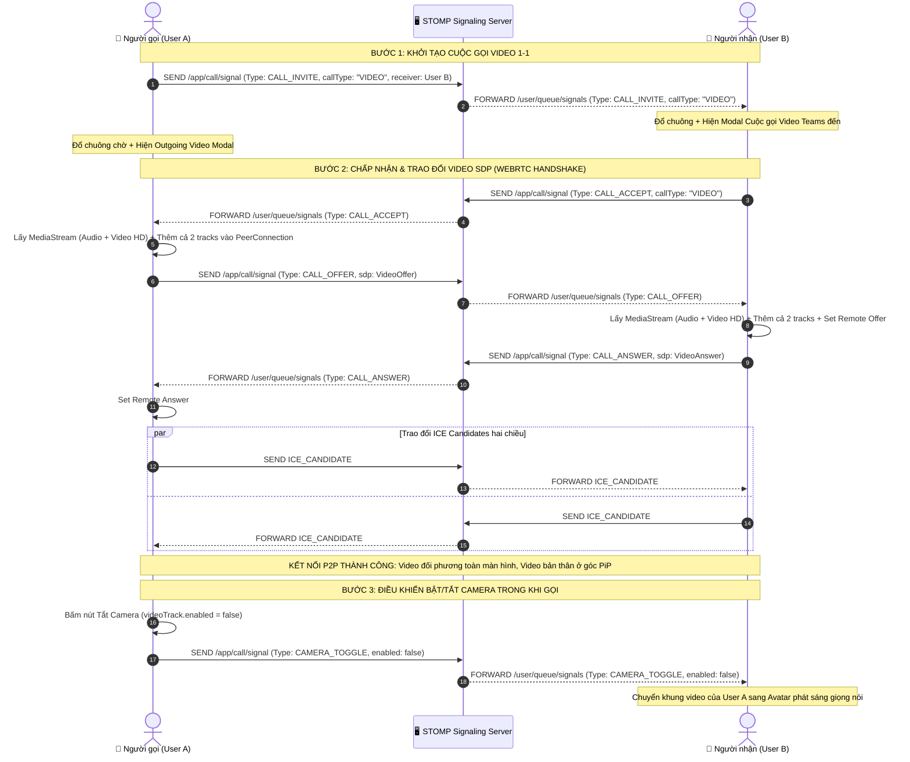
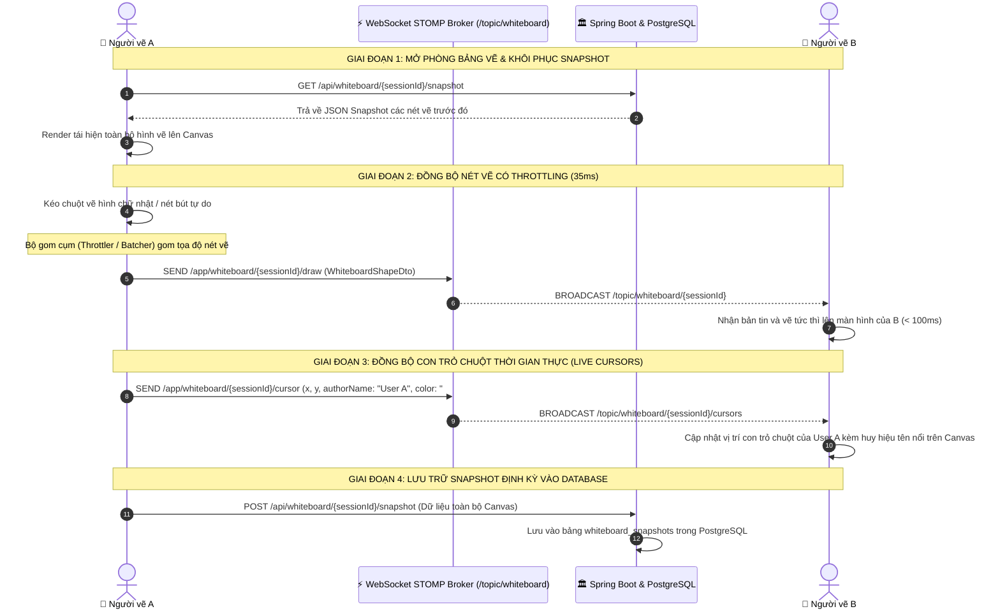

# KẾ HOẠCH CHI TIẾT TUẦN 3 (SPRINT 3) - TASK CHECKLIST
> **Dự án:** Ứng dụng Họp & Nhắn tin Trực tuyến (`promessagesapp` - Teams Clone)  
> **Thời gian thực hiện:** Tuần 3 (7 ngày)  
> **Quy mô đội ngũ:** 3 Thành viên (Fullstack theo phân hệ chức năng)  
> **Cách sử dụng tài liệu:** Các thành viên tích chọn `[x]` vào ô checkbox ngay sau khi hoàn thành công việc để báo cáo tiến độ hàng ngày (Daily Standup).

---

## 1. TỔNG QUAN TIẾN ĐỘ SPRINT 3

- [ ] **Tiến độ chung toàn đội:** `33.3%` (TV1 hoàn thành 100%, TV2 và TV3 đã hoàn thiện kế hoạch chi tiết và bắt đầu triển khai)
- [x] **Mục tiêu 1:** Hệ thống Chat Nhóm (`GROUP`), Quản lý thành viên nhóm (Thêm/Xóa/Rời nhóm) và Upload/Hiển thị Hình ảnh & Tệp đính kèm (TV1) - **ĐÃ HOÀN THÀNH 100%**
- [ ] **Mục tiêu 2:** Cuộc gọi Video 1-1 WebRTC P2P chất lượng cao, giao diện Picture-in-Picture (PiP), điều khiển Bật/Tắt Camera & Micro, và Bộ chọn thiết bị đầu vào (TV2) - **ĐANG THỰC HIỆN**
- [ ] **Mục tiêu 3:** Bảng vẽ tương tác nâng cao (Hình học, Text box), Đồng bộ nét vẽ thời gian thực có Throttling/Debouncing, Hiển thị con trỏ chuột đa người dùng và Lưu Snapshot vào CSDL (TV3) - **ĐANG THỰC HIỆN**

---

## 2. CHECKLIST CHI TIẾT CHO THÀNH VIÊN 1 (AUTH, USER & CHAT CORE LEAD)
> **Nhánh Git:** `feature/w3-tv1-group-chat-and-media`  
> **Trọng tâm:** Xây dựng hoàn chỉnh tính năng Chat Nhóm (`ConversationType.GROUP`), Quản lý danh sách thành viên nhóm (`ADMIN` / `MEMBER`), dịch vụ lưu trữ & tải lên hình ảnh/tệp đính kèm (`/api/files/upload`) và giao diện đa phương tiện chuẩn Microsoft Teams.

### 📅 Ngày 1: Mở rộng Mô hình Dữ liệu & DTOs cho Chat Nhóm và Tệp đính kèm
- [x] **Sáng:** Họp Sprint Planning Tuần 3, thống nhất quy tắc phân quyền nhóm (`ADMIN` tạo nhóm/xóa thành viên, `MEMBER` tham gia/rời nhóm) và cấu trúc lưu trữ tệp.
- [x] **Chiều:** Mở rộng `Message.java` bổ sung trường `fileName` (tên tệp gốc) và `fileSize` (dung lượng byte).
- [x] **Chiều:** Bổ sung phương thức truy vấn trong `ConversationMemberRepository.java` (`deleteByConversationIdAndUserId`, `countByConversationId`).
- [x] **Chiều:** Tạo bộ DTOs phục vụ nghiệp vụ nhóm và tải tệp:
  - [x] `ConversationMemberDto.java` (Thông tin thành viên kèm trạng thái Online/Offline và Role `ADMIN | MEMBER`).
  - [x] `CreateGroupConversationRequest.java` (Tên nhóm, avatar, danh sách `memberIds`).
  - [x] `AddGroupMembersRequest.java` (Danh sách `userIds` thêm mới vào nhóm).
  - [x] `UpdateGroupConversationRequest.java` (Đổi tên nhóm, cập nhật avatar nhóm).
  - [x] `FileUploadResponse.java` (Thông tin tệp sau khi tải lên, tự động phân loại `IMAGE` hoặc `FILE`).

### 📅 Ngày 2: Dịch vụ Lưu trữ Tệp & REST API Upload (`/api/files/upload`)
- [x] **Sáng:** Xây dựng `FileStorageService.java` và `FileStorageServiceImpl.java`:
  - [x] Tự động khởi tạo thư mục lưu trữ `uploads/` và cấu hình giới hạn dung lượng 25MB trong `application.yml`.
  - [x] Kiểm tra tính hợp lệ của tệp, chống lỗi Path Traversal (`..`), chuẩn hóa tên file gắn UUID duy nhất.
  - [x] Tự động nhận diện phần mở rộng và MIME type để phân loại `MessageType.IMAGE` (`png`, `jpg`, `jpeg`, `gif`, `webp`, `svg`) hoặc `MessageType.FILE` (`pdf`, `docx`, `zip`, `txt`...).
- [x] **Chiều:** Tạo `FileController.java`:
  - [x] `POST /api/files/upload`: Nhận `MultipartFile`, lưu đĩa và trả về URL truy cập tệp.
  - [x] `GET /api/files/{fileName:.+}`: Phục vụ hiển thị ảnh trực tiếp (`inline`) hoặc tải tệp về máy (`attachment`).
  - [x] Cập nhật `SecurityConfig.java` cho phép trình duyệt tải tài nguyên tĩnh `GET /api/files/**` để thẻ `` hiển thị mượt mà.

### 📅 Ngày 3: Nghiệp vụ Quản lý Nhóm & Thành viên (`ChatService` & `ConversationController`)
- [x] **Sáng:** Nâng cấp `ChatServiceImpl.java`:
  - [x] `createGroupConversation()`: Tạo nhóm mới, gán người tạo làm `ADMIN`, thêm các thành viên được mời làm `MEMBER`, tự động phát sinh tin nhắn hệ thống (`MessageType.SYSTEM`).
  - [x] `getConversationMembers()`: Lấy danh sách thành viên sắp xếp ưu tiên Quản trị viên (`ADMIN`) lên đầu.
  - [x] `addMembersToGroup()`: Thêm thành viên mới vào nhóm và phát thông báo hệ thống vào luồng chat.
  - [x] `removeMemberFromGroup()`: Kiểm tra quyền `ADMIN` khi mời thành viên ra khỏi nhóm hoặc cho phép thành viên tự rời nhóm.
  - [x] `updateGroupConversation()`: Cập nhật tên và ảnh đại diện nhóm.
- [x] **Chiều:** Mở rộng `ConversationController.java`:
  - [x] `POST /api/conversations/group`: Tạo nhóm chat mới.
  - [x] `PUT /api/conversations/{id}/group`: Cập nhật thông tin nhóm.
  - [x] `GET /api/conversations/{id}/members`: Lấy danh sách thành viên nhóm.
  - [x] `POST /api/conversations/{id}/members`: Thêm thành viên vào nhóm.
  - [x] `DELETE /api/conversations/{id}/members/{userId}`: Xóa thành viên hoặc rời nhóm.

### 📅 Ngày 4: Giao diện Modal Tạo Nhóm Mới (`CreateGroupModal`) & Bộ lọc Sidebar
- [x] **Sáng:** Cập nhật `frontend/src/types/chat.ts`, `apiClient.ts` (hỗ trợ `FormData` upload) và `chatService.ts`.
- [x] **Chiều:** Xây dựng Component `CreateGroupModal.tsx`:
  - [x] Ô nhập tên nhóm kèm kiểm tra hợp lệ.
  - [x] Tìm kiếm người dùng theo thời gian thực và chọn nhiều thành viên (Multi-select với checkbox).
  - [x] Hiển thị danh sách thành viên đã chọn dưới dạng thẻ Chip/Badge kèm nút xóa nhanh.
- [x] **Chiều:** Nâng cấp `ChatSidebar.tsx`:
  - [x] Bổ sung nút **"Tạo nhóm"** nổi bật trên thanh tiêu đề Sidebar.
  - [x] Bổ sung thanh lọc 3 tab: **Tất cả** | **Cá nhân** | **Nhóm**.
  - [x] Hiển thị biểu tượng nhóm và số lượng thành viên trên mỗi dòng hội thoại nhóm.

### 📅 Ngày 5: Giao diện Quản lý Thành viên Nhóm (`GroupMembersPanel`)
- [x] **Sáng:** Xây dựng Component `GroupMembersPanel.tsx` (Drawer bên phải khung chat):
  - [x] Hiển thị thông tin tổng quan của nhóm (Avatar nhóm, tên nhóm, tổng số thành viên).
  - [x] Danh sách thành viên kèm chấm trạng thái Online/Offline và huy hiệu **Admin** (biểu tượng vương miện vàng).
- [x] **Chiều:** Tích hợp thao tác quản trị ngay trên Panel:
  - [x] Khung tìm kiếm và nút **"Thêm thành viên mới"** trực tiếp vào nhóm đang mở.
  - [x] Nút **"Mời ra khỏi nhóm"** (chỉ hiển thị cho Quản trị viên nhóm).
  - [x] Nút **"Rời khỏi nhóm trò chuyện"** ở cuối bảng điều khiển.

### 📅 Ngày 6: Đính kèm & Hiển thị Hình ảnh / Tệp Tài liệu trong `ChatWindow`
- [x] **Sáng:** Nâng cấp thanh soạn thảo tin nhắn trong `ChatWindow.tsx`:
  - [x] Nút chọn Hình ảnh (`ImageIcon`) và nút đính kèm Tệp bất kỳ (`Paperclip`).
  - [x] Thanh xem trước (Attachment Preview Bar) hiển thị ảnh thu nhỏ (Thumbnail), tên tệp, dung lượng (KB/MB) và nút hủy trước khi gửi.
- [x] **Chiều:** Render đa phương tiện trong luồng tin nhắn:
  - [x] Tin nhắn `SYSTEM`: Hiển thị dạng nhãn thông báo căn giữa cho các sự kiện tạo nhóm, thêm/rời thành viên.
  - [x] Tin nhắn `IMAGE`: Hiển thị ảnh bo góc sắc nét, hỗ trợ click mở **Lightbox phóng to toàn màn hình** và tải ảnh gốc.
  - [x] Tin nhắn `FILE`: Hiển thị thẻ tài liệu (File Card) chuẩn Teams kèm dung lượng và nút **Tải xuống trực tiếp (`Download`)**.

### 📅 Ngày 7: Kiểm thử Tự động (Unit Tests) & Nghiệm thu Sprint 3
- [x] **Sáng:** Mở rộng `ChatServiceTest.java` (kiểm thử tạo nhóm, thêm thành viên, chặn thành viên thường xóa người khác, gửi tin nhắn ảnh).
- [x] **Sáng:** Viết mới `FileStorageServiceTest.java` (kiểm thử lưu ảnh `IMAGE`, lưu tài liệu `FILE`, bắt lỗi file rỗng).
- [x] **Chiều:** Chạy `./mvnw test` đạt 100% PASS (22/22 test cases) và `npm run build` thành công không lỗi TypeScript.

---

## 3. CHECKLIST CHI TIẾT CHO THÀNH VIÊN 2 (CALLING & WEBRTC LEAD)
> **Nhánh Git:** `feature/w3-tv2-video-call-1-1`  
> **Trọng tâm:** Nâng cấp WebRTC từ Audio-only lên Video Call 1-1 P2P chất lượng cao, thiết kế giao diện Picture-in-Picture (PiP) chuẩn Microsoft Teams, thanh điều khiển cuộc gọi nổi (Floating Bar), cơ chế bật/tắt Camera & Micro mượt mà, bộ chọn thiết bị đầu vào (Device Selector) và phân loại lưu vết lịch sử cuộc gọi Video.

### 📅 Ngày 1: Mở rộng Mô hình Tín hiệu Signaling & Phân loại Cuộc gọi Video Backend
- [ ] **Sáng:** Phân tích giao thức Signaling hỗ trợ đàm phán Video SDP:
  - [ ] Bổ sung trường `callType: "AUDIO" | "VIDEO"` trong `CallSession.java`, `CallLogDto.java` và `SignalMessage.java`.
  - [ ] Mở rộng `SignalType.java` bổ sung các bản tin điều khiển mới:
    - [ ] `CAMERA_TOGGLE`: Thông báo đối phương trạng thái camera (Bật/Tắt) tức thì.
    - [ ] `MIC_TOGGLE`: Thông báo trạng thái micro của đối phương.
    - [ ] `DEVICE_CHANGE`: Báo hiệu chuyển đổi nguồn thu media.
- [ ] **Chiều:** Cập nhật `SignalingController.java` & `CallService.java`:
  - [ ] Tiếp nhận tín hiệu `CALL_INVITE` mang `callType = "VIDEO"`, lưu chính xác vào CSDL `call_sessions`.
  - [ ] Chuyển tiếp bản tin `CAMERA_TOGGLE` hai chiều qua `/user/{receiverId}/queue/signals`.
  - [ ] Ghi log chi tiết chu kỳ sống của cuộc gọi Video từ lúc tạo Offer đến khi kết thúc phiên.

### 📅 Ngày 2: Nâng cấp `useMediaStream` & Quản lý Thiết bị Đa phương tiện
- [ ] **Sáng:** Nâng cấp Custom Hook `frontend/src/hooks/useMediaStream.ts`:
  - [ ] Hỗ trợ gọi `navigator.mediaDevices.getUserMedia({ audio: true, video: true })` với độ phân giải HD tiêu chuẩn (`ideal: 1280x720`, `frameRate: 30`).
  - [ ] Quản lý trạng thái: `isVideoEnabled`, `localVideoStream`, `hasCameraDevice`.
  - [ ] Viết hàm `toggleVideo()`: Đảo trạng thái `videoTrack.enabled = !videoTrack.enabled` và bắn tín hiệu `CAMERA_TOGGLE`.
  - [ ] Xây dựng cơ chế Fallback an toàn: Nếu thiết bị không có webcam hoặc người dùng từ chối cấp quyền Camera, hệ thống tự động giáng cấp về Audio Call mà không làm sập ứng dụng.
- [ ] **Chiều:** Xây dựng module quản lý thiết bị `frontend/src/services/deviceService.ts`:
  - [ ] Gọi `navigator.mediaDevices.enumerateDevices()` để phân loại danh sách Microphone, Webcam và Loa/Tai nghe.
  - [ ] Viết hàm `switchCamera(deviceId)` và `switchMicrophone(deviceId)`.
  - [ ] Viết hàm `switchSpeaker(deviceId)` sử dụng API `HTMLMediaElement.setSinkId()`.

### 📅 Ngày 3: Nâng cấp WebRTC Core (`webrtcManager.ts`) cho Luồng Video P2P
- [ ] **Sáng:** Mở rộng `frontend/src/services/webrtcManager.ts`:
  - [ ] Hỗ trợ thêm cả 2 tracks `audio` và `video` vào đối tượng `RTCPeerConnection`.
  - [ ] Cấu hình SDP munging ưu tiên codec video `VP8` / `H264` để đảm bảo độ trễ thấp và tương thích đa trình duyệt.
  - [ ] Xử lý sự kiện `ontrack`: Tự động gắn luồng remote stream vào thẻ `<video autoPlay playsInline />` của đối phương.
- [ ] **Chiều:** Quản lý thay thế Track (Track Replacement) và Renegotiation:
  - [ ] Viết hàm `replaceVideoTrack(newTrack)` sử dụng `RTCRtpSender.replaceTrack()` để đổi webcam mà không làm đứt kết nối P2P.
  - [ ] Lắng nghe sự kiện `negotiationneeded` để sẵn sàng cho tính năng nâng cấp cuộc gọi thoại lên video.
  - [ ] Xử lý sự kiện `iceconnectionstatechange` phát hiện mạng chập chờn (`disconnected` / `failed`) để hiển thị cảnh báo người dùng.

### 📅 Ngày 4: Giao diện Video Call 1-1 Chuẩn Teams & Picture-in-Picture (PiP)
- [ ] **Sáng:** Xây dựng Component `frontend/src/components/calling/VideoCallView.tsx`:
  - [ ] Khung video đối phương (Remote Video) hiển thị toàn bộ không gian trung tâm, tỉ lệ `object-cover` mượt mà.
  - [ ] Khung video của bản thân (Local Video) ở góc dưới bên phải dạng Picture-in-Picture (PiP):
    - [ ] Bo góc `rounded-xl`, viền bóng tím nhẹ chuẩn Teams.
    - [ ] Áp dụng hiệu ứng lật gương (Mirror Effect: `scale-x-[-1]`) để người dùng nhìn mình tự nhiên nhất.
    - [ ] Hỗ trợ click hoặc kéo thả đổi vị trí các góc màn hình (Top-Right, Bottom-Right, Bottom-Left).
- [ ] **Chiều:** Xử lý Fallback hiển thị khi tắt Camera:
  - [ ] Nếu đối phương tắt Camera: Khung video đối phương mượt mà chuyển sang hiển thị Avatar lớn có vòng tròn tên viết tắt (Initials Avatar) kèm viền sáng phát hiện tiếng nói.
  - [ ] Nếu bản thân tắt Camera: Khung PiP chuyển sang hiển thị Avatar nhỏ kèm icon `VideoOff`.
  - [ ] Huy hiệu hiển thị chất lượng đường truyền (Connection Quality Badge: Xanh lá / Vàng / Đỏ).

### 📅 Ngày 5: Thanh Điều Khiển Cuộc Gọi Nổi & Modal Cài Đặt Thiết Bị
- [ ] **Sáng:** Nâng cấp `FloatingCallBar.tsx` và `ActiveCallModal.tsx`:
  - [ ] Thanh điều khiển nổi bo tròn dạng thanh đen mờ (`bg-[#201f1f]/90 backdrop-blur-md`) cố định ở cạnh dưới video.
  - [ ] Nút **Bật/Tắt Micro**: Icon `Mic` (nền tối khi bật) / `MicOff` (nền đỏ khi tắt).
  - [ ] Nút **Bật/Tắt Camera**: Icon `Video` (xanh tím khi bật) / `VideoOff` (nền đỏ khi tắt).
  - [ ] Nút **Cài đặt thiết bị (Settings)**: Icon `Settings` mở menu popover chọn nhanh thiết bị.
  - [ ] Nút **Phóng to / Thu nhỏ toàn màn hình (Fullscreen Toggle)**: Icon `Maximize2` / `Minimize2`.
  - [ ] Nút **Kết thúc cuộc gọi**: Nút tròn đỏ nổi bật ở giữa với icon `PhoneOff`.
- [ ] **Chiều:** Xây dựng Component `frontend/src/components/calling/DeviceSettingsModal.tsx`:
  - [ ] Dropdown chọn Microphone đầu vào kèm thanh đo cường độ âm thanh (Audio VU Meter Bar) chuyển động theo giọng nói.
  - [ ] Dropdown chọn Camera đầu vào kèm khung xem trước (Camera Preview) trước khi lưu.
  - [ ] Dropdown chọn Loa/Tai nghe đầu ra kèm nút "Phát âm thanh kiểm tra (Test Sound)".

### 📅 Ngày 6: Tích hợp Nút Video Call vào ChatWindow & Lịch sử Cuộc gọi CallsPage
- [ ] **Sáng:** Tích hợp nút Video Call vào Header của `ChatWindow.tsx`:
  - [ ] Gắn sự kiện `onClick` cho nút `<button title="Bắt đầu cuộc gọi video (WebRTC Video)">` với icon `Video`.
  - [ ] Khi bấm nút: Kích hoạt `startCall(conversation.otherUser.id, conversation.otherUser.displayName, 'VIDEO')`.
  - [ ] Cập nhật `IncomingCallModal.tsx`: Hiển thị nhãn *"Cuộc gọi Video Teams đến..."* kèm icon camera nhấp nháy để người nhận nhận biết rõ ràng.
- [ ] **Chiều:** Cập nhật trang `CallsPage.tsx`:
  - [ ] Hiển thị biểu tượng phân loại cuộc gọi: Huy hiệu `Video` (icon tím) hoặc `Thoại` (icon xanh lá).
  - [ ] Bổ sung bộ lọc phụ lọc riêng danh sách các cuộc gọi Video.
  - [ ] Nút "Gọi lại" hỗ trợ gọi lại đúng loại cuộc gọi cũ (Voice hoặc Video).

### 📅 Ngày 7: Unit Tests Backend, Kiểm thử Trình duyệt Chéo & Nghiệm thu
- [ ] **Sáng:** Viết Unit Tests Backend & Kiểm tra Type Frontend:
  - [ ] Mở rộng `CallServiceTest.java`: Kiểm tra khởi tạo và kết thúc cuộc gọi với `CallType.VIDEO`.
  - [ ] Mở rộng `SignalingControllerTest.java`: Kiểm tra chuyển tiếp bản tin `CAMERA_TOGGLE` tới đúng user queue.
  - [ ] Chạy `npm run build` xác nhận không có lỗi TypeScript hay cú pháp.
- [ ] **Chiều:** Kiểm thử thực tế liên thông 2 Trình duyệt (Chrome & Edge):
  - [ ] Đăng nhập 2 tài khoản, bấm nút Gọi Video từ khung chat.
  - [ ] Xác nhận hình ảnh 2 bên hiển thị rõ nét, âm thanh đồng bộ, không bị méo tiếng hay giật khung hình.
  - [ ] Bấm tắt/bật Camera trên từng bên, kiểm tra chuyển đổi tức thì giữa Video và Avatar.
  - [ ] Kiểm tra di chuyển cửa sổ PiP và phóng to toàn màn hình.
  - [ ] Kết thúc cuộc gọi và xác nhận lịch sử cuộc gọi ghi nhận chính xác `VIDEO`.

---

## 4. CHECKLIST CHI TIẾT CHO THÀNH VIÊN 3 (WHITEBOARD & AI LEAD)
> **Nhánh Git:** `feature/w3-tv3-whiteboard-sync`  
> **Trọng tâm:** Xây dựng hệ thống Bảng vẽ Tương tác Trực tuyến Đa người dùng (Real-time Collaborative Whiteboard Canvas): Bộ công cụ hình học vector & hộp văn bản (Text box), cơ chế đồng bộ WebSocket STOMP có Throttling/Debouncing tránh nghẽn băng thông, hiển thị con trỏ chuột thời gian thực (Live Multi-user Cursors) và lưu trữ/khôi phục Snapshot bảng vẽ trong PostgreSQL.

### 📅 Ngày 1: Mô hình Dữ liệu Bảng vẽ Vector, Entity & DTOs Backend
- [ ] **Sáng:** Thiết kế cấu trúc dữ liệu nét vẽ vector và hình học thời gian thực:
  - [ ] Thống nhất schema JSON: `id`, `type: 'FREEHAND' | 'RECTANGLE' | 'CIRCLE' | 'LINE' | 'ARROW' | 'TEXT'`, `points`, `strokeColor`, `strokeWidth`, `fillColor`, `text`, `fontSize`, `authorId`, `authorName`.
  - [ ] Thiết kế bảng CSDL `whiteboard_sessions` và `whiteboard_snapshots`.
- [ ] **Chiều:** Tạo Entity và Repositories Backend:
  - [ ] Tạo Entity `WhiteboardSession.java` (id, conversationId, title, createdBy, createdAt, updatedAt).
  - [ ] Tạo Entity `WhiteboardSnapshot.java` (id, whiteboardSessionId, snapshotData dạng `TEXT` hoặc `JSONB`, version, createdAt).
  - [ ] Tạo `WhiteboardSessionRepository.java` và `WhiteboardSnapshotRepository.java`.
  - [ ] Tạo các DTOs:
    - [ ] `WhiteboardShapeDto.java` (Chứa thông số chi tiết của từng đối tượng vẽ).
    - [ ] `WhiteboardCursorDto.java` (Tọa độ chuột `x, y`, tên người dùng, màu con trỏ).
    - [ ] `WhiteboardSnapshotRequest.java` / `WhiteboardSnapshotResponse.java`.

### 📅 Ngày 2: WebSocket STOMP Controller & REST API Whiteboard Backend
- [ ] **Sáng:** Xây dựng `WhiteboardWebSocketController.java`:
  - [ ] Lắng nghe `@MessageMapping("/whiteboard/{sessionId}/draw")`: Nhận nét vẽ/hình học mới và broadcast tới `/topic/whiteboard/{sessionId}`.
  - [ ] Lắng nghe `@MessageMapping("/whiteboard/{sessionId}/cursor")`: Nhận tọa độ chuột và broadcast tới `/topic/whiteboard/{sessionId}/cursors`.
  - [ ] Lắng nghe `@MessageMapping("/whiteboard/{sessionId}/clear")`: Nhận lệnh xóa bảng và broadcast tín hiệu reset tới toàn phòng.
- [ ] **Chiều:** Xây dựng `WhiteboardService.java` và `WhiteboardController.java`:
  - [ ] `POST /api/whiteboard/{sessionId}/snapshot`: Lưu snapshot toàn bộ trạng thái bảng vẽ định dạng JSON vào CSDL.
  - [ ] `GET /api/whiteboard/{sessionId}/snapshot`: Lấy snapshot phiên bản mới nhất khi người dùng mới truy cập phòng vẽ.
  - [ ] `POST /api/whiteboard/session`: Khởi tạo phiên bảng vẽ mới gắn liền với cuộc trò chuyện hoặc cuộc họp.

### 📅 Ngày 3: Xây dựng Bộ Công cụ Hình học Vector trên Canvas Frontend
- [ ] **Sáng:** Nâng cấp Canvas Engine trong `frontend/src/pages/WhiteboardPage.tsx`:
  - [ ] Quản lý trạng thái bảng vẽ bằng React State: `shapes: WhiteboardShape[]`.
  - [ ] Xây dựng cơ chế vẽ thử thời gian thực (Ghost Preview Rendering): Hiển thị hình dáng tạm thời khi người dùng đang giữ và kéo chuột trước khi nhả chuột (`onMouseUp`).
- [ ] **Chiều:** Xây dựng các công cụ hình học vector chuẩn xác:
  - [ ] **Hình chữ nhật (Rectangle)**: Tính toán tọa độ gốc `(x, y)`, chiều rộng `width` và chiều cao `height`.
  - [ ] **Hình tròn / Elip (Circle / Ellipse)**: Tính tâm và bán kính theo véc-tơ kéo chuột.
  - [ ] **Đường thẳng (Line)**: Kéo thả đường thẳng giữa điểm đầu `(x1, y1)` và điểm cuối `(x2, y2)`.
  - [ ] **Mũi tên chỉ dẫn (Arrow)**: Vẽ đường thẳng kèm đầu mũi tên tam giác sắc nét ở điểm cuối.
  - [ ] Hỗ trợ phím giữ `Shift` để tự động khóa tỷ lệ hình vuông và hình tròn hoàn hảo.

### 📅 Ngày 4: Công cụ Hộp Văn Bản (Text Box), Phông chữ & Bảng Màu Teams
- [ ] **Sáng:** Xây dựng công cụ Hộp Văn bản (Text Box Tool):
  - [ ] Nhấp chuột vào bất kỳ vị trí nào trên bảng để mở khung soạn thảo văn bản nội dòng (Inline ContentEditable Input).
  - [ ] Hỗ trợ gõ tiếng Việt có dấu chuẩn xác (tương thích Unikey/EVKey, không bị nuốt ký tự khi render Canvas).
  - [ ] Nhấn `Enter` hoặc nhấp ra ngoài để xác nhận chuyển thành đối tượng văn bản vector trên Canvas.
  - [ ] Tùy chọn kích cỡ chữ: Nhỏ (14px), Vừa (18px), Lớn (24px), Tiêu đề (36px).
- [ ] **Chiều:** Hoàn thiện Thanh Công Cụ & Bảng Màu chuẩn Microsoft:
  - [ ] Bảng màu nhanh chuẩn Teams: Tím Teams (`#5B5FC7`), Đen than (`#242424`), Đỏ tươi (`#D13438`), Xanh lá (`#107C41`), Xanh dương (`#0078D4`), Cam (`#FF8C00`).
  - [ ] Bộ chọn độ dày nét vẽ: Mảnh (2px), Vừa (4px), Đậm (8px), Siêu đậm (12px).
  - [ ] Tùy chọn chế độ màu viền (Stroke) và màu tô nền (Fill) trong suốt hoặc có màu.

### 📅 Ngày 5: Cơ chế Gom cụm Nét vẽ (Throttling / Debouncing) & Hook Đồng bộ Hai Chiều
- [ ] **Sáng:** Xây dựng Custom Hook `frontend/src/hooks/useWhiteboardSync.ts`:
  - [ ] Tự động kết nối và subscribe các topic `/topic/whiteboard/{sessionId}` và `/topic/whiteboard/{sessionId}/cursors`.
  - [ ] Tự động gọi API lấy Snapshot cũ khi vừa tải trang để dựng lại toàn bộ nội dung vẽ.
- [ ] **Chiều:** Cài đặt cơ chế Throttling / Batching dữ liệu nét vẽ:
  - [ ] Đối với nét vẽ tự do (Freehand Pencil), sự kiện `mousemove` phát sinh tần suất rất cao (lên tới 120Hz).
  - [ ] Áp dụng thuật toán gom cụm (Batching) mỗi 35ms hoặc làm mượt đường cong Bézier (Quadratic Bézier Curve) trước khi phát bản tin STOMP.
  - [ ] Giữ vững tốc độ khung hình 60 FPS mượt mà, loại bỏ hiện tượng đơ giật khi có 3-4 người cùng vẽ cùng lúc.

### 📅 Ngày 6: Hiển thị Con Trỏ Chuột Đa Người Dùng (Live Cursors) & Hoàn tác/Làm lại
- [ ] **Sáng:** Xây dựng tính năng Con trỏ chuột đa người dùng thời gian thực:
  - [ ] Bắt sự kiện di chuột trên Canvas, gửi tọa độ `(x, y)` có Throttling (mỗi 40ms) qua `/app/whiteboard/{sessionId}/cursor`.
  - [ ] Render con trỏ chuột của các thành viên khác: Con trỏ hình mũi tên sắc nét kèm huy hiệu (Badge) tên người dùng và màu sắc riêng biệt (ví dụ: `Nguyễn Văn A` màu tím, `Trần Thị B` màu cam).
  - [ ] Tự động ẩn con trỏ chuột sau 3 giây nếu người đó ngừng di chuyển hoặc rời trang.
- [ ] **Chiều:** Xây dựng cơ chế Hoàn tác / Làm lại (Undo / Redo) & Xóa bảng:
  - [ ] Quản lý mảng lịch sử thao tác `historyStack` và chỉ mục `historyIndex`.
  - [ ] Hỗ trợ phím tắt chuẩn: `Ctrl + Z` để Hoàn tác (Undo) và `Ctrl + Y` hoặc `Ctrl + Shift + Z` để Làm lại (Redo).
  - [ ] Nút "Xóa toàn bộ bảng" (Clear Board) kèm hộp thoại xác nhận và broadcast tín hiệu reset tới toàn phòng.

### 📅 Ngày 7: Xuất Ảnh PNG / SVG, Unit Tests Backend & Nghiệm thu Đồng bộ 2 Trình duyệt
- [ ] **Sáng:** Xây dựng tính năng Xuất Bảng vẽ & Tự động lưu:
  - [ ] Nút **"Xuất bảng vẽ"** trên thanh công cụ: Xuất ảnh PNG độ nét cao (`canvas.toDataURL('image/png')`) và tải về máy tính.
  - [ ] Cơ chế Auto-save Snapshot: Tự động gửi bản tin lưu snapshot lên Backend sau mỗi 30 giây có thay đổi.
- [ ] **Chiều:** Kiểm thử Tự động Backend & Nghiệm thu Liên thông 2 Trình duyệt:
  - [ ] Viết `WhiteboardServiceTest.java`: Kiểm thử lưu snapshot, truy vấn snapshot, validate dữ liệu JSON.
  - [ ] Kiểm thử đồng thời trên 2 tab trình duyệt:
    - [ ] Tab A vẽ hình hộp và gõ chữ -> Tab B xuất hiện tức thì trong dưới 100ms.
    - [ ] Tab A di chuột -> Tab B nhìn thấy con trỏ chuột mang tên Tab A lướt trên màn hình.
    - [ ] Tab A bấm Xóa bảng -> Tab B nhận tín hiệu và làm sạch canvas tức thì.
  - [ ] Chạy `./mvnw test` và `npm run build` xác nhận 100% PASS không lỗi.

---

## 5. BẢNG CHECKLIST WBS TUẦN 3 (DEFINITION OF DONE)

| Trạng thái | Mã Task | Người phụ trách | Tên công việc chi tiết | Ước lượng | Tiêu chuẩn Hoàn thành (DoD) |
| :---: | :--- | :---: | :--- | :---: | :--- |
| [x] | **W3-TV1-01** | **TV1** | Mở rộng Entity & DTOs cho Group Chat & File | 4h | Đầy đủ thông tin vai trò thành viên, tên tệp và kích thước tệp. |
| [x] | **W3-TV1-02** | **TV1** | Dịch vụ Lưu trữ & API Upload File (`/api/files/upload`) | 6h | Upload ảnh/tài liệu thành công, phân loại đúng `IMAGE` / `FILE`, tải/xem trực tiếp. |
| [x] | **W3-TV1-03** | **TV1** | Nghiệp vụ & REST API Tạo nhóm, Thêm/Xóa thành viên | 8h | Tạo nhóm gán Admin, thêm/xóa/rời nhóm phát sinh tin nhắn hệ thống chuẩn xác. |
| [x] | **W3-TV1-04** | **TV1** | Giao diện `CreateGroupModal` & Bộ lọc Nhóm trên Sidebar | 6h | Chọn nhiều thành viên, tạo nhóm tức thì, lọc danh sách Cá nhân / Nhóm mượt mà. |
| [x] | **W3-TV1-05** | **TV1** | Giao diện `GroupMembersPanel` quản lý thành viên | 6h | Xem danh sách thành viên, thêm người mới, Admin xóa thành viên, rời nhóm. |
| [x] | **W3-TV1-06** | **TV1** | Đính kèm Ảnh/File & Lightbox xem ảnh trong `ChatWindow` | 8h | Preview tệp trước khi gửi, hiển thị ảnh inline + Lightbox, thẻ tải file trực tiếp. |
| [x] | **W3-TV1-07** | **TV1** | Unit Tests `ChatServiceTest` & `FileStorageServiceTest` | 4h | Toàn bộ test suite Backend & Frontend build PASS 100%. |
| [ ] | **W3-TV2-01** | **TV2** | Mở rộng Signaling Server & Phân loại Cuộc gọi Video | 6h | Lưu đúng `callType = VIDEO` vào CSDL; xử lý bản tin `CAMERA_TOGGLE` và `MIC_TOGGLE`. |
| [ ] | **W3-TV2-02** | **TV2** | Nâng cấp `useMediaStream` & Dịch vụ Device Selector | 6h | Thu luồng Video HD 720p, chuyển đổi camera/micro/loa mượt mà, an toàn khi không có webcam. |
| [ ] | **W3-TV2-03** | **TV2** | Nâng cấp WebRTC Core (`webrtcManager.ts`) cho Video P2P | 8h | Đàm phán video SDP VP8/H264, gắn video stream vào DOM, hỗ trợ `replaceVideoTrack`. |
| [ ] | **W3-TV2-04** | **TV2** | Giao diện Video Call 1-1 & Picture-in-Picture (PiP) | 8h | Video đối phương toàn màn hình, local PiP lật gương bo góc, avatar fallback khi tắt cam. |
| [ ] | **W3-TV2-05** | **TV2** | Thanh Điều Khiển Nổi & Modal Cài Đặt Thiết Bị | 6h | Nút bật/tắt cam/mic nền đỏ khi tắt, thanh đo âm lượng nhảy theo giọng nói, test loa. |
| [ ] | **W3-TV2-06** | **TV2** | Tích hợp Nút Video Call vào Chat & Trang Lịch sử | 6h | Bấm gọi video từ header chat; trang CallsPage hiển thị huy hiệu Video và lọc chuẩn xác. |
| [ ] | **W3-TV2-07** | **TV2** | Unit Tests Backend & Test Video Call 2 Trình duyệt | 6h | `./mvnw test` đạt 100% PASS; gọi video mượt mà, không giật hình giữa 2 trình duyệt. |
| [ ] | **W3-TV3-01** | **TV3** | Mô hình Dữ liệu Bảng vẽ Vector, Entity & DTOs Backend | 6h | Schema JSON vector chuẩn xác; Entity `WhiteboardSession` và `WhiteboardSnapshot` lưu PostgreSQL. |
| [ ] | **W3-TV3-02** | **TV3** | WebSocket STOMP Controller & REST API Whiteboard | 6h | Broadcast nét vẽ `/topic/whiteboard/{id}`, API lưu và khôi phục snapshot JSON hoạt động 200 OK. |
| [ ] | **W3-TV3-03** | **TV3** | Bộ Công cụ Hình học Vector (Hộp, Tròn, Đường, Mũi tên) | 8h | Kéo thả vẽ hình có preview mượt mà; giữ Shift khóa tỷ lệ vuông/tròn hoàn hảo. |
| [ ] | **W3-TV3-04** | **TV3** | Công cụ Hộp Văn bản (Text Box), Phông chữ & Bảng màu | 6h | Gõ tiếng Việt có dấu trực tiếp trên Canvas, đổi cỡ chữ, thanh màu chuẩn Teams. |
| [ ] | **W3-TV3-05** | **TV3** | Cơ chế Gom cụm Nét vẽ (Throttling) & Hook Đồng bộ | 8h | Gom cụm điểm chuột 35ms, duy trì 60 FPS, hook `useWhiteboardSync` đồng bộ hai chiều. |
| [ ] | **W3-TV3-06** | **TV3** | Con Trỏ Chuột Thời Gian Thực (Live Cursors) & Undo/Redo | 8h | Con trỏ kèm tên và màu sắc di chuyển mượt mà; hoàn tác `Ctrl+Z` và làm lại `Ctrl+Y`. |
| [ ] | **W3-TV3-07** | **TV3** | Xuất Bảng vẽ PNG / SVG, Unit Tests Backend & Nghiệm thu | 6h | Nút xuất ảnh PNG tải file thành công; test đồng bộ 2 trình duyệt dưới 100ms. |

---

## 6. SƠ ĐỒ TUẦN TỰ BẢN TIN SIGNALING CUỘC GỌI VIDEO 1-1 & BẬT/TẮT CAMERA (TV2)

---

## 7. KIẾN TRÚC ĐỒNG BỘ BẢNG VẼ THỜI GIAN THỰC & CON TRỎ CHUỘT (TV3)

