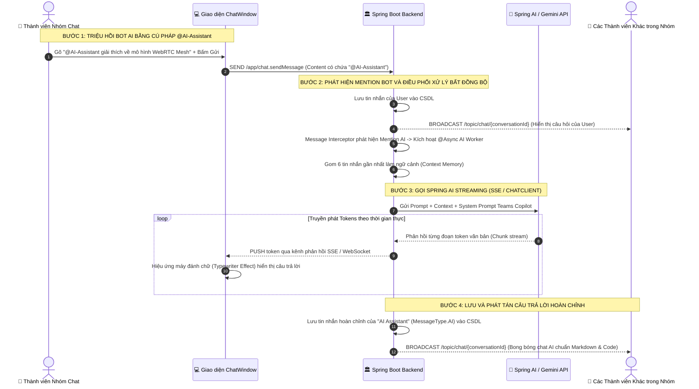
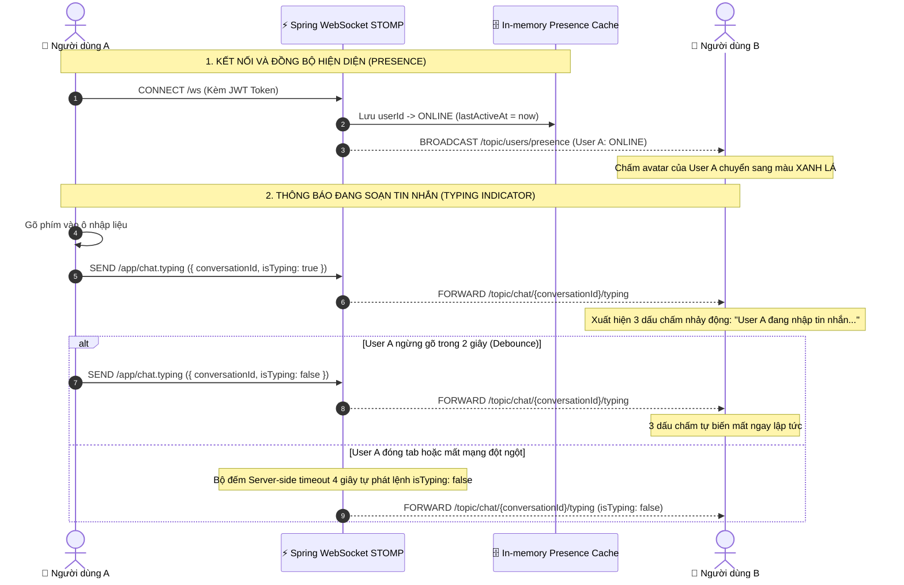

# KẾ HOẠCH CHI TIẾT TUẦN 4 (SPRINT 4) - TASK CHECKLIST
> **Dự án:** Ứng dụng Họp & Nhắn tin Trực tuyến (`promessagesapp` - Teams Clone)  
> **Thời gian thực hiện:** Tuần 4 (7 ngày)  
> **Quy mô đội ngũ:** 3 Thành viên (Fullstack theo phân hệ chức năng)  
> **Cách sử dụng tài liệu:** Các thành viên tích chọn `[x]` vào ô checkbox ngay sau khi hoàn thành công việc để báo cáo tiến độ hàng ngày (Daily Standup).

---

## 1. TỔNG QUAN TIẾN ĐỘ SPRINT 4

- [ ] **Tiến độ chung toàn đội:** `0%` (Chính thức khởi động Sprint 4 sau khi hoàn thành toàn bộ nền móng Sprint 3)
- [ ] **Mục tiêu 1:** Trải nghiệm Chat nâng cao: Cơ chế Hiện diện Người dùng (User Presence: Online/Offline/Busy/Away), Thông báo "Đang soạn tin nhắn..." (Typing Indicator) và Tìm kiếm Lịch sử Tin nhắn (TV1)
- [ ] **Mục tiêu 2:** Hội nghị Truyền hình Nhóm đa điểm (Group Mesh Video Calling 3-5 người), Bố cục lưới Video Grid tự co giãn theo số lượng và Phát hiện giọng nói hoạt động (VAD - Voice Activity Detection) (TV2)
- [ ] **Mục tiêu 3:** Trợ lý Trí tuệ Nhân tạo trong Chat (Teams Copilot AI Assistant): Tích hợp Spring AI / Gemini API, Truyền phát câu trả lời thời gian thực bằng SSE, Triệu hồi `@AI-Assistant`, Render Markdown & Syntax Code Block (TV3)

---

## 2. CHECKLIST CHI TIẾT CHO THÀNH VIÊN 1 (AUTH, USER & CHAT CORE LEAD)
> **Nhánh Git:** `feature/w4-tv1-presence-and-typing`  
> **Trọng tâm:** Xây dựng hệ thống quản lý hiện diện thời gian thực (User Presence), cơ chế phát hiện đang nhập tin (Typing Indicator) với bộ đếm tự tắt (Auto-debounce), Menu đổi trạng thái người dùng thủ công và công cụ tìm kiếm tin nhắn trong hội thoại.

### 📅 Ngày 1: Mô hình Trạng thái Hiện diện & Lắng nghe Sự kiện Kết nối Backend
- [ ] **Sáng:** Họp Sprint 4 Planning, thống nhất các trạng thái hiện diện (`ONLINE`, `OFFLINE`, `BUSY`, `AWAY`) và giao thức gửi gói tin Typing qua STOMP.
- [ ] **Sáng:** Mở rộng `User.java`:
  - [ ] Bổ sung enum `UserPresenceStatus: ONLINE | OFFLINE | BUSY | AWAY`.
  - [ ] Bổ sung trường `lastActiveAt` (thời điểm hoạt động cuối cùng).
- [ ] **Chiều:** Xây dựng `WebSocketEventListener.java`:
  - [ ] Bắt sự kiện `SessionConnectedEvent`: Trích xuất `userId` từ STOMP Principal, cập nhật trạng thái `ONLINE` vào Cache/In-memory Map.
  - [ ] Bắt sự kiện `SessionDisconnectEvent`: Đánh dấu `OFFLINE`, ghi nhận `lastActiveAt` và kích hoạt hẹn giờ 10 giây (Grace Period) để tránh nháy trạng thái khi người dùng F5 tải lại trang.
- [ ] **Chiều:** Tạo DTOs phục vụ Presence:
  - [ ] `UserPresenceDto.java` (`userId`, `status`, `lastActiveAt`).
  - [ ] `UpdatePresenceRequest.java` (cho phép người dùng tự đổi sang `BUSY` hoặc `AWAY`).

### 📅 Ngày 2: Dịch vụ Presence & Kênh Broadcast STOMP (`/topic/users/presence`)
- [ ] **Sáng:** Xây dựng `PresenceService.java` và `PresenceServiceImpl.java`:
  - [ ] Sử dụng ConcurrentHashMap hoặc Redis để lưu giữ bảng ánh xạ `userId -> PresenceInfo`.
  - [ ] Phương thức `updateUserStatus(UUID userId, UserPresenceStatus status)`.
  - [ ] Phương thức `getOnlineUsers()` lấy danh sách toàn bộ người dùng đang online.
  - [ ] Phương thức `broadcastUserPresence(UUID userId, UserPresenceStatus status)`.
- [ ] **Chiều:** Tạo REST Controller & WebSocket Channel:
  - [ ] Endpoint `GET /api/users/presence`: Lấy danh sách trạng thái hiện tại của tất cả người dùng.
  - [ ] Endpoint `PUT /api/users/me/presence`: Người dùng cập nhật trạng thái thủ công (ví dụ: bận họp, không làm phiền).
  - [ ] Kênh STOMP Broadcast: Mỗi khi có sự thay đổi trạng thái, gửi bản tin đến `/topic/users/presence`.

### 📅 Ngày 3: Kênh Báo hiệu "Đang soạn tin nhắn..." (Typing Indicator Backend)
- [ ] **Sáng:** Thiết kế giao thức Typing qua STOMP:
  - [ ] Tạo DTO `TypingNotification.java` (`conversationId`, `userId`, `displayName`, `isTyping`).
  - [ ] Tạo controller mapping trong `ChatWebSocketController.java`:
    - `@MessageMapping("/chat.typing")`: Tiếp nhận sự kiện gõ phím từ client.
    - Forward bản tin tức thì tới `/topic/chat/{conversationId}/typing`.
- [ ] **Chiều:** Cơ chế quản lý bộ đếm tự tắt Typing (Debouncing Server-side):
  - [ ] Nếu client không gửi sự kiện gõ tiếp trong 4 giây, tự động kích hoạt thông báo `isTyping = false`.
  - [ ] Đảm bảo không bị lặp bản tin hoặc rò rỉ bộ nhớ khi người dùng rời cuộc trò chuyện đột ngột.

### 📅 Ngày 4: Giao diện Trạng thái Người dùng trên Avatar & Menu Đổi Trạng thái
- [ ] **Sáng:** Xây dựng Hook `frontend/src/hooks/useUserPresence.ts`:
  - [ ] Kết nối STOMP topic `/topic/users/presence` để lắng nghe thay đổi trạng thái của bạn bè trong danh bạ.
  - [ ] Lưu giữ State danh sách trạng thái người dùng trong toàn ứng dụng (`presenceMap`).
- [ ] **Chiều:** Cập nhật Component Avatar & Header Profile:
  - [ ] Bổ sung huy hiệu chấm màu góc dưới avatar (`StatusBadge.tsx`):
    - 🟢 Xanh lá (`#13a10e`): Trực tuyến (`ONLINE`).
    - 🔴 Đỏ viền trắng (`#d13438`): Đang bận (`BUSY`).
    - 🟡 Vàng cam (`#ffaa44`): Vắng mặt (`AWAY`).
    - ⚪ Xám rỗng viền (`#8a8886`): Ngoại tuyến (`OFFLINE`).
  - [ ] Menu Profile trên góc phải thanh Header Teams: Cho phép click chọn nhanh trạng thái cá nhân để thông báo cho đồng nghiệp.

### 📅 Ngày 5: Giao diện Hiệu ứng Soạn tin nhắn (Typing Indicator UI)
- [ ] **Sáng:** Tích hợp bộ phát sự kiện Typing trong `ChatWindow.tsx`:
  - [ ] Bắt sự kiện `onChange` và `onKeyDown` trên ô soạn thảo tin nhắn.
  - [ ] Áp dụng Debounce 1.5 giây: Khi người dùng gõ, gửi `{ isTyping: true }`, nếu dừng gõ sau 2 giây thì tự động gửi `{ isTyping: false }`.
- [ ] **Chiều:** Xây dựng Component hiển thị `TypingIndicator.tsx`:
  - [ ] Đặt ở góc dưới danh sách tin nhắn, ngay phía trên thanh soạn thảo.
  - [ ] Hiệu ứng 3 dấu chấm nhảy động (Jumping Dots Animation) chuẩn phong cách Teams.
  - [ ] Hiển thị câu văn thông minh:
    - 1 người: *"[Nguyễn Văn A] đang nhập tin nhắn..."*
    - 2 người: *"[Nguyễn Văn A] và [Trần Thị B] đang nhập tin nhắn..."*
    - Nhiều hơn 2 người: *"Nhiều người đang nhập tin nhắn..."*

### 📅 Ngày 6: REST API & Giao diện Tìm kiếm Tin nhắn trong Hội thoại
- [ ] **Sáng:** Xây dựng API tìm kiếm tin nhắn Backend:
  - [ ] Viết câu truy vấn Full-text Search hoặc `LIKE %keyword%` trong `MessageRepository.java`.
  - [ ] Endpoint `GET /api/conversations/{id}/messages/search?q={keyword}` hỗ trợ tìm kiếm không phân biệt chữ hoa/thường.
- [ ] **Chiều:** Xây dựng Khung Tìm kiếm Tin nhắn trên giao diện `ChatWindow.tsx`:
  - [ ] Nút biểu tượng Kính lúp (`SearchIcon`) trên Header phòng chat mở thanh tìm kiếm nhanh.
  - [ ] Hiển thị danh sách kết quả khớp kèm thời gian gửi và tô sáng từ khóa (Keyword Highlight).
  - [ ] Khi click vào một kết quả tìm kiếm: Cuộn mượt mà (Smooth Scroll) trực tiếp tới vị trí tin nhắn đó trong luồng trò chuyện và nhấp nháy làm nổi bật bóng tin nhắn trong 2 giây.

### 📅 Ngày 7: Unit Tests Backend & Kiểm thử Đồng bộ Tải Trạng thái
- [ ] **Sáng:** Viết Unit Tests Backend:
  - [ ] `PresenceServiceTest.java`: Kiểm thử cập nhật trạng thái, kết nối, ngắt kết nối, timeout.
  - [ ] `MessageSearchTest.java`: Kiểm thử tìm kiếm tin nhắn theo từ khóa có dấu và không dấu.
- [ ] **Chiều:** Kiểm thử kịch bản liên thông:
  - [ ] Mở 2 trình duyệt: User A mở chat với User B.
  - [ ] User A gõ phím -> Màn hình User B hiện dấu 3 chấm nhảy động ngay lập tức (< 100ms).
  - [ ] User A ngừng gõ -> Dấu 3 chấm tự biến mất sau 2 giây.
  - [ ] User A đổi trạng thái sang "Đang bận" -> Chấm avatar trên màn hình User B chuyển ngay sang màu đỏ.
  - [ ] Chạy `./mvnw test` đạt 100% PASS và `npm run build` thành công.

---

## 3. CHECKLIST CHI TIẾT CHO THÀNH VIÊN 2 (CALLING & WEBRTC LEAD)
> **Nhánh Git:** `feature/w4-tv2-group-mesh-video`  
> **Trọng tâm:** Xây dựng hệ thống Hội nghị Truyền hình Nhóm đa điểm (Group Mesh Video Calling cho 3-5 người): Quản lý phòng họp Backend, giao thức Mesh Signaling, quản lý đồng thời nhiều `RTCPeerConnection` Client-side, bố cục Video Grid tự co giãn theo số lượng thành viên, và Bộ phát hiện giọng nói hoạt động (Voice Activity Detection - VAD) làm nổi bật viền người nói.

### 📅 Ngày 1: Mô hình Quản lý Phòng Họp Nhóm Backend (`MeetingRoom`)
- [ ] **Sáng:** Phân tích kiến trúc Mesh WebRTC cho phòng 3-5 người:
  - [ ] Mỗi thành viên trong phòng sẽ duy trì $N-1$ kết nối P2P trực tiếp tới tất cả thành viên còn lại (Peer-to-Peer Full Mesh).
  - [ ] Thiết kế bảng `meeting_rooms` và `room_participants`.
- [ ] **Chiều:** Xây dựng Entity và Repository:
  - [ ] Entity `MeetingRoom.java` (`id`, `roomCode`, `conversationId`, `hostId`, `status: ACTIVE | ENDED`, `startedAt`, `endedAt`).
  - [ ] Entity `RoomParticipant.java` (`id`, `meetingRoomId`, `userId`, `joinedAt`, `leftAt`, `isAudioMuted`, `isVideoMuted`).
  - [ ] `MeetingRoomRepository.java` & `RoomParticipantRepository.java`.
- [ ] **Chiều:** Tạo DTOs:
  - [ ] `CreateMeetingRequest.java`, `MeetingRoomDto.java`, `ParticipantStateDto.java`.

### 📅 Ngày 2: Giao thức Mesh Signaling STOMP cho Cuộc gọi Nhóm
- [ ] **Sáng:** Mở rộng `SignalType.java` bổ sung các bản tin Mesh:
  - [ ] `ROOM_JOIN`: Thành viên yêu cầu tham gia phòng họp.
  - [ ] `ROOM_LEAVE`: Thành viên chủ động rời phòng hoặc đóng tab.
  - [ ] `USER_JOINED`: Thông báo tới toàn bộ người trong phòng có thành viên mới vào.
  - [ ] `USER_LEFT`: Thông báo tới toàn bộ người trong phòng có thành viên vừa rời đi.
  - [ ] `MESH_OFFER` & `MESH_ANSWER`: SDP Offer/Answer kèm `targetUserId` cụ thể trong phòng.
  - [ ] `MESH_ICE_CANDIDATE`: Ứng viên mạng ICE gắn định danh người gửi và người nhận cụ thể.
- [ ] **Chiều:** Xây dựng `MeetingSignalingController.java`:
  - [ ] `@MessageMapping("/call/group/{roomCode}/join")`: Thêm người dùng vào danh sách phòng và broadcast `USER_JOINED` tới kênh `/topic/call/group/{roomCode}`.
  - [ ] `@MessageMapping("/call/group/{roomCode}/leave")`: Rời phòng và tự động đóng phòng nếu không còn ai.
  - [ ] Chuyển tiếp định tuyến bản tin Offer/Answer/ICE trực tiếp tới `/user/{targetUserId}/queue/signals`.

### 📅 Ngày 3: Kiến trúc Đa Kết Nối Mesh WebRTC Client (`MeshWebRtcManager`)
- [ ] **Sáng:** Tạo lớp quản lý đa kết nối `frontend/src/services/meshWebRtcManager.ts`:
  - [ ] Quản lý Map các đối tượng kết nối: `peerConnections: Map<string, RTCPeerConnection>` (key là `userId` của từng đối phương).
  - [ ] Quản lý Map luồng video nhận được: `remoteStreams: Map<string, MediaStream>`.
- [ ] **Chiều:** Cài đặt luồng kết nối Mesh 2 chiều:
  - [ ] Khi nhận được `USER_JOINED` (người mới tham gia): Client chủ nhà khởi tạo `RTCPeerConnection` mới, gắn track camera/micro của mình, tạo SDP Offer và gửi tới người mới.
  - [ ] Khi nhận được `MESH_OFFER`: Người mới tạo `RTCPeerConnection` tương ứng với người gửi, gắn track của mình, tạo SDP Answer và gửi phản hồi.
  - [ ] Lắng nghe sự kiện `ontrack` cho từng peer: Thu thập stream và lưu vào `remoteStreams` kèm hàm callback thông báo React State re-render.
  - [ ] Xử lý dọn dẹp khi nhận `USER_LEFT`: Đóng và xóa `RTCPeerConnection` của người rời đi khỏi Map, giải phóng tài nguyên.

### 📅 Ngày 4: Bố Cục Video Grid Đa Người Dùng Co Giãn Tự Động (Responsive Dynamic Grid)
- [ ] **Sáng:** Thiết kế Component `frontend/src/components/calling/GroupVideoGrid.tsx`:
  - [ ] Tự động tính toán số cột và hàng CSS Grid dựa trên tổng số người trong phòng:
    - **1 người:** Toàn màn hình đơn (1x1).
    - **2 người:** Chia đôi màn hình ngang hoặc dọc (1x2 hoặc 2x1).
    - **3 - 4 người:** Lưới 4 ô đối xứng hoàn hảo (2x2 Grid).
    - **5 người:** 1 khung hình lớn cho người đang nói + 4 khung nhỏ bên cạnh hoặc lưới 2x3.
- [ ] **Chiều:** Thiết kế Component con `VideoTile.tsx`:
  - [ ] Thẻ `<video autoPlay playsInline />` hiển thị nét căng, bo góc `rounded-lg`.
  - [ ] Thanh nhãn dưới góc trái khung video: Hiển thị tên thành viên, biểu tượng Micro (bật/tắt gạch chéo đỏ).
  - [ ] Nếu thành viên tắt Camera: Tự động chuyển sang Avatar tròn lớn mang màu sắc ngẫu nhiên kèm tên viết tắt.

### 📅 Ngày 5: Bộ Phát Hiện Giọng Nói Hoạt Động (Voice Activity Detection - VAD)
- [ ] **Sáng:** Xây dựng Hook `frontend/src/hooks/useVoiceActivityDetection.ts`:
  - [ ] Sử dụng Web Audio API: Khởi tạo `AudioContext` và đối tượng phân tích tần số `AnalyserNode`.
  - [ ] Trích xuất luồng audio từ mỗi `MediaStream` (cả local và remote).
  - [ ] Tính toán cường độ âm lượng (Root Mean Square - RMS / Decibel) theo chu kỳ `requestAnimationFrame`.
  - [ ] Đặt ngưỡng kích hoạt (Threshold: e.g. -45dB): Nếu âm lượng vượt ngưỡng liên tục trong 200ms -> Đánh dấu là đang phát biểu (`isSpeaking = true`).
- [ ] **Chiều:** Hiệu ứng giao diện Người đang nói (Active Speaker Highlight):
  - [ ] Khung `VideoTile` của người đang nói tự động xuất hiện viền phát sáng màu tím Teams hoặc xanh lục (`ring-4 ring-[#5b5fc7] shadow-lg transition-all duration-300`).
  - [ ] Chế độ "Tập trung người nói" (Speaker Focus Mode): Người dùng có thể click chọn ghim một người lên màn hình lớn, các thành viên khác thu nhỏ thành dải video strip ở cạnh dưới.

### 📅 Ngày 6: Tích hợp Nút Gọi Nhóm & Bảng Quản lý Người Tham gia (`ParticipantsDrawer`)
- [ ] **Sáng:** Tích hợp nút Gọi Nhóm vào Header Chat Nhóm:
  - [ ] Trong các cuộc trò chuyện loại `GROUP`, nút gọi chuyển thành icon "Họp nhóm ngay" (Meet Now / Group Call).
  - [ ] Khi bấm: Tự động tạo phòng `MeetingRoom`, sinh mã phòng ngắn gọn và phát tin nhắn mời họp kèm link tham gia trực tiếp vào luồng chat nhóm.
- [ ] **Chiều:** Xây dựng Bảng điều khiển Người tham gia (`ParticipantsDrawer.tsx`):
  - [ ] Mở từ cạnh phải màn hình cuộc gọi.
  - [ ] Liệt kê toàn bộ thành viên đang có mặt trong phòng họp kèm trạng thái Micro/Cam.
  - [ ] Người chủ phòng (Host) có quyền bấm "Tắt tiếng tất cả" (Mute All).
  - [ ] Nút sao chép mã phòng hoặc link mời họp nhanh (`navigator.clipboard.writeText`).

### 📅 Ngày 7: Unit Tests Backend & Thử Nghiệm Họp Nhóm 3-4 Trình Duyệt Thực Tế
- [ ] **Sáng:** Viết Unit Tests Backend:
  - [ ] `MeetingRoomServiceTest.java`: Kiểm thử tạo phòng họp, thêm thành viên, cập nhật trạng thái kết thúc phòng.
  - [ ] `MeetingSignalingControllerTest.java`: Kiểm thử broadcast `USER_JOINED` và định tuyến bản tin SDP Mesh.
- [ ] **Chiều:** Thử nghiệm kịch bản phòng họp 3 người đồng thời:
  - [ ] Mở 3 trình duyệt (Chrome bình thường, Chrome Ẩn danh, Microsoft Edge).
  - [ ] Đăng nhập 3 tài khoản: User A, User B, User C.
  - [ ] User A bấm Bắt đầu cuộc họp nhóm -> User B và User C click vào thông báo trong chat để tham gia.
  - [ ] Xác nhận giao diện lưới tự chia thành bố cục 3 ô cân đối.
  - [ ] Kiểm tra âm thanh và hình ảnh của cả 3 người truyền thông suốt qua lại lẫn nhau.
  - [ ] User B nói -> Khung hình của User B lập tức phát sáng viền tím VAD.
  - [ ] User C thoát phòng -> Khung video của C biến mất, lưới tự động co lại thành 2 ô chia đôi cho A và B.
  - [ ] Chạy `./mvnw test` và `npm run build` PASS 100%.

---

## 4. CHECKLIST CHI TIẾT CHO THÀNH VIÊN 3 (WHITEBOARD & AI LEAD)
> **Nhánh Git:** `feature/w4-tv3-spring-ai-bot`  
> **Trọng tâm:** Tích hợp Trợ lý Trí tuệ Nhân tạo vào ứng dụng (Teams Copilot AI Assistant): Tích hợp Spring AI / Gemini API, Endpoint Streaming câu trả lời thời gian thực qua Server-Sent Events (SSE), Triệu hồi bot trực tiếp bằng cú pháp `@AI-Assistant` trong chat nhóm hoặc nút "Hỏi AI", và Xây dựng Component bong bóng chat AI render Markdown kèm Code Block Highlight.

### 📅 Ngày 1: Cấu hình Spring AI / Gemini Client & Thiết kế Tầng Service Backend
- [ ] **Sáng:** Bổ sung dependencies Spring AI vào `pom.xml`:
  - [ ] `spring-ai-openai-spring-boot-starter` hoặc Google Gemini Client SDK.
  - [ ] Cấu hình API Key, Model (`gemini-1.5-flash` hoặc `gpt-4o-mini`), Temperature, Max Tokens an toàn trong `application.yml`.
- [ ] **Sáng:** Thiết kế System Prompt chuẩn trợ lý Microsoft Teams:
  - [ ] Định nghĩa tính cách bot: Chuyên nghiệp, ngắn gọn, súc tích, am hiểu công nghệ, trả lời bằng tiếng Việt chuẩn ngữ pháp, luôn hỗ trợ format Markdown và Code đẹp mắt.
- [ ] **Chiều:** Xây dựng Interface và Service nền tảng:
  - [ ] Tạo `AiService.java`:
    - `Flux<String> streamChat(String userPrompt, List<ChatMessageContext> history)`: Trả về luồng phản hồi từng từ (Streaming tokens).
    - `String generateText(String prompt)`: Trả về câu trả lời đồng bộ (Synchronous fallback).
  - [ ] Tạo `AiServiceImpl.java` cài đặt kết nối API qua Prompt Template và ChatClient.

### 📅 Ngày 2: Endpoint Streaming SSE Backend (`/api/ai/chat/stream`) & Quản lý Lịch sử Chat
- [ ] **Sáng:** Xây dựng REST Controller `AiController.java`:
  - [ ] Endpoint `GET /api/ai/chat/stream?prompt={message}&conversationId={id}`:
    - Thiết lập Header `Content-Type: text/event-stream`.
    - Trả về đối tượng `Flux<ServerSentEvent<String>>`.
    - Tự động bắt lỗi nếu API Key hết hạn hoặc vượt hạn mức (Quota Limit Exceeded) và trả về thông báo lỗi thân thiện.
- [ ] **Chiều:** Tích hợp Bộ nhớ Lịch sử Hội thoại (Context Memory):
  - [ ] Trích xuất 6 tin nhắn gần nhất trong cuộc trò chuyện từ `MessageRepository.java` để làm ngữ cảnh đầu vào (Chat History Context).
  - [ ] Đóng gói ngữ cảnh giúp bot hiểu được chủ đề câu chuyện đang thảo luận mà không bị trả lời lạc đề.

### 📅 Ngày 3: Tích hợp Bot `@AI-Assistant` vào Luồng Nhắn Tin Nhóm Chat
- [ ] **Sáng:** Xây dựng Bộ Đón Bắt Tin Nhắn Thông Minh (Chat Message Interceptor / Service Trigger):
  - [ ] Trong `ChatServiceImpl.java`: Khi lưu tin nhắn mới, kiểm tra nội dung có chứa chuỗi `@AI-Assistant` hoặc `@bot` không.
  - [ ] Nếu có: Đánh dấu tin nhắn chứa Mention Bot và kích hoạt luồng xử lý bất đồng bộ (`@Async` Task) để sinh câu trả lời AI.
- [ ] **Chiều:** Lưu trữ và Phát tán Tin nhắn Phản hồi của Bot:
  - [ ] Tạo người dùng hệ thống đặc biệt (Virtual System User): `id: "00000000-0000-0000-0000-000000000001"`, `displayName: "AI Assistant"`, `avatarUrl: "/assets/ai-avatar.png"`.
  - [ ] Lưu tin nhắn câu trả lời với `messageType: MessageType.AI` vào bảng `messages`.
  - [ ] Broadcast tin nhắn AI qua kênh STOMP `/topic/chat/{conversationId}` để toàn bộ thành viên trong nhóm chat cùng đọc được câu trả lời.

### 📅 Ngày 4: Giao diện Triệu Hồi AI trong Khung Soạn Thảo (Frontend Mention Suggestion)
- [ ] **Sáng:** Nâng cấp ô nhập liệu trong `ChatWindow.tsx`:
  - [ ] Bắt ký tự gõ `@`: Tự động bật lên Menu gợi ý người dùng (Mention Dropdown Popover).
  - [ ] Đưa mục **"✨ AI Assistant (Trợ lý Copilot)"** lên vị trí đầu tiên kèm icon tia sáng lấp lánh (Sparkles icon).
  - [ ] Hỗ trợ phím mũi tên `Up / Down` và phím `Enter` hoặc `Tab` để tự động điền `@AI-Assistant ` vào ô nhập.
- [ ] **Chiều:** Bổ sung Nút bấm Nhanh "Hỏi AI" trên thanh công cụ chat:
  - [ ] Đặt cạnh nút đính kèm ảnh và file: Nút biểu tượng `Sparkles` màu tím Teams gradient (`text-purple-600 hover:bg-purple-50`).
  - [ ] Bấm nút sẽ tự động chèn tiền tố `@AI-Assistant ` vào ô soạn thảo và focus chuột để người dùng gõ câu hỏi ngay lập tức.

### 📅 Ngày 5: Component Hiển Thị Bong Bóng Chat AI & Hiệu ứng Gõ Chữ Thời Gian Thực
- [ ] **Sáng:** Xây dựng Custom Hook `frontend/src/hooks/useAiStream.ts`:
  - [ ] Sử dụng API `EventSource` hoặc `fetch` đọc `ReadableStream`.
  - [ ] Nhận từng mảnh văn bản (chunks) từ endpoint SSE `/api/ai/chat/stream`.
  - [ ] Ghép nối liên tục vào State tin nhắn tạm thời tạo hiệu ứng hiển thị từng chữ (Typewriter Effect).
- [ ] **Chiều:** Xây dựng Component `frontend/src/components/chat/AiMessageBubble.tsx`:
  - [ ] Thiết kế phong cách Microsoft Teams Copilot:
    - Viền tím phát sáng tinh tế (`border-purple-200 bg-gradient-to-r from-purple-50/40 to-indigo-50/30`).
    - Huy hiệu nổi bật: **"✨ AI Assistant"** màu tím đậm kèm nhãn nhỏ *"Copilot"* ở góc.
    - Con trỏ nhấp nháy màu tím biểu thị bot đang trong quá trình sinh văn bản.
    - Nút thao tác dưới câu trả lời: Nút "Sao chép câu trả lời" (`CopyIcon`), Nút "Hài lòng" (`ThumbsUp`), Nút "Chưa hài lòng" (`ThumbsDown`).

### 📅 Ngày 6: Render Định Dạng Markdown Toàn Diện & Highlight Khối Code (Code Block)
- [ ] **Sáng:** Tích hợp bộ thư viện parse Markdown:
  - [ ] Cài đặt `react-markdown`, `remark-gfm` (hỗ trợ bảng table, checklist, strikethrough).
  - [ ] Cài đặt `rehype-highlight` hoặc `prismjs` phục vụ tô màu cú pháp mã nguồn.
- [ ] **Chiều:** Tùy biến hiển thị khối Code chuẩn phong cách lập trình viên:
  - [ ] Khung nền đen xám tối chuẩn VS Code (`bg-[#1e1e1e] text-[#d4d4d4] rounded-lg p-3 font-mono text-sm`).
  - [ ] Header khối code: Hiển thị tên ngôn ngữ (Java, TypeScript, Python, SQL, HTML, JSON...) và nút "Sao chép mã" (`Copy Code`) kèm thông báo *"Đã sao chép!"* khi click.
  - [ ] Định dạng danh sách gạch đầu dòng, tiêu đề đậm nhạt, trích dẫn blockquote hiển thị trang nhã, dễ đọc.

### 📅 Ngày 7: Rate Limiting Chống Spam Token, Unit Tests & Nghiệm Thu Toàn Diện
- [ ] **Sáng:** Xây dựng cơ chế Giới hạn Tần suất gọi AI (Rate Limiter Backend):
  - [ ] Giới hạn mỗi người dùng chỉ được gửi tối đa 10 câu hỏi AI trong vòng 1 phút để tránh cạn kiệt Quota API.
  - [ ] Nếu vượt quá giới hạn, trả về mã lỗi 429 kèm thông báo: *"Bạn đang thao tác quá nhanh, vui lòng thử lại sau 1 phút"*.
- [ ] **Chiều:** Viết Unit Tests & Kiểm thử Liên thông:
  - [ ] Viết `AiServiceTest.java`: Mock ChatClient kiểm tra sinh câu trả lời thành công và xử lý ngoại lệ khi mất kết nối mạng bên thứ ba.
  - [ ] Kiểm thử luồng thực tế trong nhóm chat:
    - [ ] Thành viên gõ: *"@AI-Assistant viết cho tôi một hàm sắp xếp mảng trong TypeScript"*.
    - [ ] Bot phản hồi tức thì qua luồng stream, văn bản tuôn ra từng chữ mượt mà.
    - [ ] Khối code TypeScript được tô màu cú pháp sắc nét, nút Copy mã hoạt động chính xác.
    - [ ] Cả 2 thành viên khác trong nhóm chat đều thấy câu trả lời xuất hiện đồng thời trên màn hình của mình.
  - [ ] Chạy `./mvnw test` và `npm run build` PASS 100%.

---

## 5. BẢNG CHECKLIST WBS TUẦN 4 (DEFINITION OF DONE)

| Trạng thái | Mã Task | Người phụ trách | Tên công việc chi tiết | Ước lượng | Tiêu chuẩn Hoàn thành (DoD) |
| :---: | :--- | :---: | :--- | :---: | :--- |
| [ ] | **W4-TV1-01** | **TV1** | Mô hình Trạng thái Người dùng & WebSocket Event Listener | 6h | Tự động phát hiện kết nối/ngắt kết nối WebSocket, cập nhật trạng thái `ONLINE`/`OFFLINE` chuẩn xác. |
| [ ] | **W4-TV1-02** | **TV1** | Dịch vụ Presence & Kênh Broadcast STOMP (`/topic/users/presence`) | 6h | Quản lý cache trạng thái, REST API lấy danh sách online, broadcast tức thì khi có biến động. |
| [ ] | **W4-TV1-03** | **TV1** | Kênh STOMP Thông báo Typing Indicator có Debounce Server | 6h | Nhận tin nhắn soạn thảo, forward tới kênh chat nhóm, tự động hủy trạng thái gõ sau 4 giây. |
| [ ] | **W4-TV1-04** | **TV1** | Giao diện Chấm Trạng thái Avatar & Menu Đổi Trạng thái | 6h | Chấm màu Online (xanh), Busy (đỏ), Away (vàng); menu profile cho phép đổi thủ công mượt mà. |
| [ ] | **W4-TV1-05** | **TV1** | Giao diện Hiệu ứng Soạn tin nhắn (Typing Indicator Dots) | 6h | Bắt sự kiện gõ phím debounce 1.5s; 3 dấu chấm nhảy động hiển thị tên người đang gõ chuẩn Teams. |
| [ ] | **W4-TV1-06** | **TV1** | REST API & Giao diện Tìm kiếm Tin nhắn trong Hội thoại | 8h | Tìm kiếm từ khóa không phân biệt hoa/thường, cuộn mượt đến tin nhắn và nhấp nháy highlight. |
| [ ] | **W4-TV1-07** | **TV1** | Unit Tests `PresenceServiceTest` & Kiểm thử Tải 50 Kết nối | 4h | Test suite backend PASS 100%; đồng bộ trạng thái và typing indicator mượt mà < 100ms. |
| [ ] | **W4-TV2-01** | **TV2** | Mô hình CSDL Phòng Họp Nhóm Backend (`MeetingRoom`) | 6h | Entity `MeetingRoom`, `RoomParticipant`; quản lý vòng đời phòng họp và danh sách người tham gia. |
| [ ] | **W4-TV2-02** | **TV2** | Giao thức Mesh Signaling STOMP cho Cuộc gọi Nhóm | 8h | Các bản tin `ROOM_JOIN`, `USER_JOINED`, `MESH_OFFER`, `MESH_ANSWER`, `USER_LEFT` chuyển tiếp chuẩn. |
| [ ] | **W4-TV2-03** | **TV2** | Quản lý Đa Kết Nối Mesh WebRTC Client (`MeshWebRtcManager`) | 8h | Quản lý Map `RTCPeerConnection` và Map `MediaStream`; kết nối P2P đa điểm 3-5 người thông suốt. |
| [ ] | **W4-TV2-04** | **TV2** | Bố cục Lưới Video Grid Đa Người Dùng Co Giãn Tự Động | 8h | Lưới CSS Grid tự co giãn theo số lượng (1x1, 1x2, 2x2, 2x3); hiển thị nhãn tên và avatar thay thế. |
| [ ] | **W4-TV2-05** | **TV2** | Bộ Phát Hiện Giọng Nói Hoạt Động (VAD) & Speaker Focus | 8h | Web Audio API phân tích âm lượng thời gian thực; tự động phát sáng viền tím quanh người phát biểu. |
| [ ] | **W4-TV2-06** | **TV2** | Tích hợp Nút Họp Nhóm trong Chat & Bảng `ParticipantsDrawer` | 6h | Bấm họp ngay trong chat nhóm gửi link mời; bảng drawer liệt kê thành viên, nút Mute All cho Host. |
| [ ] | **W4-TV2-07** | **TV2** | Unit Tests Backend & Thử Nghiệm Họp Nhóm 3-4 Trình Duyệt | 6h | Kiểm thử thực tế 3-4 trình duyệt đồng thời; lưới video mượt mà, âm thanh trong trẻo, VAD chuẩn. |
| [ ] | **W4-TV3-01** | **TV3** | Cấu hình Spring AI / Gemini Client & Thiết kế `AiService` | 6h | Tích hợp thư viện AI; thiết lập System Prompt chuẩn phong cách trợ lý Teams Copilot tiếng Việt. |
| [ ] | **W4-TV3-02** | **TV3** | REST Endpoint Streaming SSE (`/api/ai/chat/stream`) & Context Memory | 8h | Truyền phát câu trả lời từng token qua SSE; nạp ngữ cảnh 6 tin nhắn gần nhất trong phòng chat. |
| [ ] | **W4-TV3-03** | **TV3** | Message Interceptor Bắt Cú Pháp `@AI-Assistant` trong Chat Nhóm | 6h | Tự động nhận diện lệnh gọi bot, gán System User "AI Assistant" và broadcast câu trả lời qua STOMP. |
| [ ] | **W4-TV3-04** | **TV3** | Giao diện Menu Gợi Ý Mention `@AI-Assistant` & Nút "Hỏi AI" | 6h | Gõ `@` hiển thị popover gợi ý bot đầu tiên; nút tia sáng Sparkles chèn cú pháp nhanh vào ô chat. |
| [ ] | **W4-TV3-05** | **TV3** | Component Bong Bóng Chat AI & Hiệu ứng Gõ Chữ Thời Gian Thực | 8h | Hook `useAiStream` đọc luồng SSE; hiệu ứng Typewriter mượt mà, viền gradient tím Teams Copilot. |
| [ ] | **W4-TV3-06** | **TV3** | Render Markdown Toàn Diện & Tô Màu Khối Code (Highlight) | 6h | Định dạng bảng biểu, danh sách, trích dẫn; khối code VS Code có nút "Sao chép mã" tiện ích. |
| [ ] | **W4-TV3-07** | **TV3** | Rate Limiting Chống Spam Token, Unit Tests & Nghiệm Thu | 4h | Giới hạn 10 câu hỏi/phút; Unit Test `AiServiceTest` PASS 100%; kiểm thử bot trong phòng chat mượt mà. |

---

## 6. SƠ ĐỒ TUẦN TỰ LƯU ĐỒ MESH WEBRTC PHÒNG HỌP NHÓM (TV2)

```mermaid
sequenceDiagram
    autonumber
    actor UserA as 👤 Người tham gia A (Chủ phòng)
    actor UserB as 👤 Người tham gia B (Đã có sẵn)
    participant SignalServer as 🖥️ STOMP Meeting Signaling Server
    actor UserC as 👤 Người tham gia C (Vừa vào phòng)

    Note over UserA, UserB: User A và User B đã có kết nối P2P trực tiếp trước đó

    Note over UserC, SignalServer: BƯỚC 1: THÀNH VIÊN MỚI THAM GIA PHÒNG HỌP
    UserC->>SignalServer: SEND /app/call/group/{roomCode}/join
    SignalServer-->>UserA: BROADCAST /topic/call/group/{roomCode} (Type: USER_JOINED, userId: User C)
    SignalServer-->>UserB: BROADCAST /topic/call/group/{roomCode} (Type: USER_JOINED, userId: User C)

    Note over UserA, UserC: BƯỚC 2: KHỞI TẠO ĐỒNG THỜI CÁC KẾT NỐI P2P (FULL MESH)
    par User A kết nối P2P tới User C
        UserA->>UserA: Tạo RTCPeerConnection mới cho User C + Gắn Audio/Video Tracks
        UserA->>SignalServer: SEND /app/call/group/{roomCode}/signal (Type: MESH_OFFER, target: User C)
        SignalServer-->>UserC: FORWARD /user/queue/signals (MESH_OFFER từ User A)
        UserC->>UserC: Tạo PeerConnection cho A + Gắn Tracks + Set Remote Offer
        UserC->>SignalServer: SEND /app/call/group/{roomCode}/signal (Type: MESH_ANSWER, target: User A)
        SignalServer-->>UserA: FORWARD /user/queue/signals (MESH_ANSWER từ User C)
    and User B kết nối P2P tới User C
        UserB->>UserB: Tạo RTCPeerConnection mới cho User C + Gắn Audio/Video Tracks
        UserB->>SignalServer: SEND /app/call/group/{roomCode}/signal (Type: MESH_OFFER, target: User C)
        SignalServer-->>UserC: FORWARD /user/queue/signals (MESH_OFFER từ User B)
        UserC->>UserC: Tạo PeerConnection cho B + Gắn Tracks + Set Remote Offer
        UserC->>SignalServer: SEND /app/call/group/{roomCode}/signal (Type: MESH_ANSWER, target: User B)
        SignalServer-->>UserB: FORWARD /user/queue/signals (MESH_ANSWER từ User C)
    end

    Note over UserA, UserB, UserC: BƯỚC 3: HIỂN THỊ LƯỚI VIDEO GRID 3 Ô CÂN ĐỐI
    Note over UserA, UserB, UserC: Thuật toán VAD theo dõi cường độ âm lượng: Ai phát biểu sẽ phát sáng viền tím!
```

---

## 7. SƠ ĐỒ KIẾN TRÚC & TUẦN TỰ TRỢ LÝ AI TRONG CHAT NHÓM (TV3)



---

## 8. SƠ ĐỒ ĐỒNG BỘ HIỆN DIỆN (PRESENCE) & SOẠN TIN (TYPING) (TV1)



