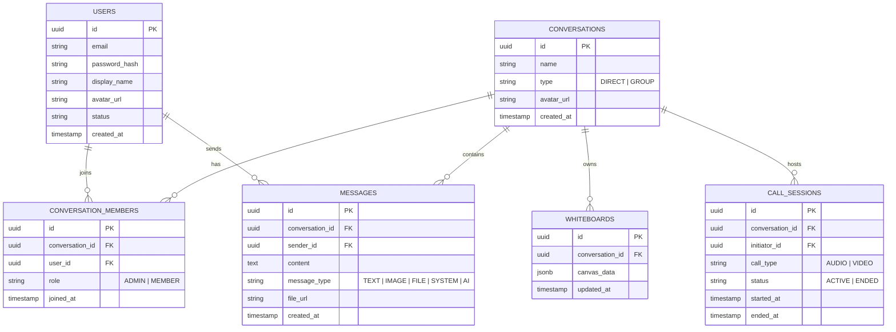

# KẾ HOẠCH PHÁT TRIỂN ỨNG DỤNG HỌP & NHẮN TIN TRỰC TUYẾN (TEAMS CLONE)
> **Tên dự án tham chiếu:** `promessagesapp` (Spring Boot Backend + Modern Web Frontend)  
> **Quy mô đội ngũ:** 3 thành viên  
> **Tổng thời gian dự kiến:** 6 - 7 tuần (Giai đoạn 1: 3-4 tuần, Giai đoạn 2: 2-3 tuần)

---

## 1. TỔNG QUAN DỰ ÁN & KIẾN TRÚC KỸ THUẬT

### 1.1 Mục tiêu dự án
Xây dựng nền tảng cộng tác và hội nghị trực tuyến thời gian thực tương tự Microsoft Teams:
- **Giai đoạn 1 (Tuần 1 - 4):** Đăng nhập/xác thực, nhắn tin thời gian thực (1-1 và nhóm), tạo nhóm/kênh, cuộc gọi thoại (Audio Call) và cuộc gọi hình ảnh (Video Call) chất lượng cao dựa trên WebRTC.
- **Giai đoạn 2 (Tuần 5 - 7):** Bảng vẽ cộng tác trực tuyến (Collaborative Whiteboard), trợ lý AI trong khung chat (tóm tắt cuộc trò chuyện, hỏi đáp kiến thức, gợi ý trả lời thông minh), chia sẻ màn hình nâng cao và đóng gói hoàn thiện.

### 1.2 Lựa chọn Công nghệ (Tech Stack)

```
[ Frontend: React / Next.js / Vite ]
       │              ▲
       │ HTTP / REST  │ WebSocket (STOMP / SockJS)
       ▼              ▼
[ Backend: Spring Boot 3.x / Java 21+ (`promessagesapp`) ]
   ├── Spring Security + JWT
   ├── Spring Data JPA + PostgreSQL / MySQL
   ├── Spring WebSocket (STOMP Broker cho Chat & Signaling)
   └── Spring AI / OpenAI / Gemini API Integration
       ▲
       │ WebRTC Peer-to-Peer & Mesh (Signaling qua Spring Boot)
       ▼
[ Media: WebRTC + STUN/TURN (Coturn) ]
```

| Tầng | Công nghệ lựa chọn | Mục đích sử dụng |
| :--- | :--- | :--- |
| **Backend** | Java (Spring Boot Starter WebMvc, WebSocket) | Xử lý nghiệp vụ, API REST, WebSocket STOMP server |
| **Database** | PostgreSQL (hoặc MySQL) + Redis (cache/presence) | Lưu trữ User, Messages, Groups, Call Logs, Whiteboard sessions |
| **Realtime** | WebSocket (STOMP protocol) | Nhận/gửi tin nhắn tức thì, trạng thái Online/Offline, WebRTC Signaling |
| **Media Calling** | WebRTC (Mesh topology cho nhóm nhỏ / P2P) | Truyền tải Audio/Video có độ trễ cực thấp, không qua server lưu trữ trung gian |
| **STUN/TURN** | Google Public STUN + Coturn Server | Vượt tường lửa/NAT cho WebRTC |
| **Frontend** | React / Vite (TypeScript, Tailwind CSS, Lucide Icons) | Giao diện chuẩn phong cách Microsoft Teams (Dark/Light mode) |
| **Whiteboard** | HTML5 Canvas / Fabric.js / Excalidraw Engine | Bảng vẽ tương tác nhiều người vẽ đồng thời |
| **AI Engine** | Spring AI + Gemini API / OpenAI API | Trợ lý ảo AI bot trong kênh chat, tóm tắt văn bản chat, gợi ý trả lời |

---

## 2. PHÂN CHIA VAI TRÒ ĐỘI NGŨ (3 THÀNH VIÊN)

| Thành viên | Vai trò chính | Trọng tâm công việc |
| :--- | :--- | :--- |
| **Thành viên A** | **Frontend & UI/UX Lead** | Thiết kế UI/UX Microsoft Teams (Sidebar, Chat Feed, Video Grid, Whiteboard Canvas), Quản lý State (Zustand/Redux), kết nối REST API & WebSocket Client. |
| **Thành viên B** | **Backend & Database / DevOps Lead** | Kiến trúc Spring Boot, thiết kế Database Schema, Bảo mật (Spring Security + JWT), Xây dựng STOMP WebSocket Server, Signaling Server, Docker & CI/CD. |
| **Thành viên C** | **Fullstack Media & AI Specialist** | Logic WebRTC phía Client & Server (RTCPeerConnection, ICE candidate, SDP Offer/Answer), Xử lý Media Stream, Tích hợp Bảng vẽ (Canvas Sync) và Tích hợp AI (Spring AI/LLM API). |

---

## 3. LỘ TRÌNH PHÁT TRIỂN CHI TIẾT (ROADMAP)

### GIAI ĐOẠN 1: CÁC TÍNH NĂNG CỐT LÕI (TUẦN 1 - 4)

#### Tuần 1: Khởi tạo Nền tảng, Xác thực (Auth) & Khung Giao diện MS Teams
*Mục tiêu: Đăng ký/đăng nhập hoàn chỉnh, cấu trúc cơ sở dữ liệu, dựng layout Teams hoàn chỉnh.*

- **Thành viên A (Frontend):**
  - Khởi tạo dự án Frontend (React + Vite + TypeScript).
  - Dựng layout chuẩn Microsoft Teams: Thanh bên (Activity, Chat, Teams, Calls), Danh sách hội thoại (Sidebar), Khung chat chính, Thanh trạng thái.
  - Trang Đăng nhập / Đăng ký / Quản lý trang cá nhân (Avatar, Tên, Trạng thái hoạt động).
- **Thành viên B (Backend):**
  - Mở rộng `promessagesapp` với các dependency: `spring-boot-starter-data-jpa`, `spring-boot-starter-security`, `jjwt`, `spring-boot-starter-validation`, `postgresql` (hoặc `mysql`).
  - Thiết kế Database Entity: `User`, `Role`, `RefreshToken`.
  - Cấu hình Spring Security 6 với JWT filter: Endpoint `/api/auth/register`, `/api/auth/login`, `/api/auth/me`.
- **Thành viên C (Fullstack Media/AI):**
  - Thiết kế cấu trúc giao tiếp WebSocket (`/ws` endpoint) sử dụng `spring-boot-starter-websocket` với STOMP.
  - Chuẩn bị kiến trúc lưu trữ trạng thái người dùng (User Presence: Online, Busy, Offline, Away) qua WebSocket session events (`SessionConnectedEvent`, `SessionDisconnectEvent`).
  - Viết tài liệu API giao tiếp (Swagger / Postman Collection).

---

#### Tuần 2: Hệ thống Nhắn tin Thời gian thực (1-1 & Nhóm) & Quản lý Nhóm
*Mục tiêu: Nhắn tin tức thì, tạo nhóm, quản lý thành viên, xem lịch sử tin nhắn.*

- **Thành viên A (Frontend):**
  - Tích hợp STOMP client (`@stomp/stompjs` hoặc `sockjs-client`).
  - Khung chat: Soạn thảo tin nhắn, hiển thị danh sách tin nhắn theo thời gian, hiển thị trạng thái đã gửi/đã nhận.
  - Modal tạo nhóm mới, thêm thành viên từ danh sách liên hệ, xem thông tin nhóm.
  - Hiển thị ai đang nhập tin nhắn (*User is typing...*).
- **Thành viên B (Backend):**
  - Database Entity: `Conversation`, `ConversationMember`, `Message`, `Attachment`.
  - API REST: Lấy lịch sử tin nhắn phân trang (Pagination), danh sách cuộc hội thoại của user.
  - Cấu hình STOMP MessageBroker (`/topic/conversation/{id}`, `/queue/messages`).
  - API quản lý nhóm: Tạo nhóm, thêm/xóa thành viên, gán quyền Admin/Member.
- **Thành viên C (Fullstack Media/AI):**
  - Xử lý upload file/ảnh/âm thanh qua REST API (hỗ trợ multipart upload hoặc cloud storage).
  - Tối ưu hóa WebSocket payload: định dạng JSON chuẩn cho tin nhắn text, file, và typing indicator.
  - Hỗ trợ thông báo tin nhắn mới khi đang ở màn hình khác (Desktop/Browser Notification).

---

#### Tuần 3: Tích hợp WebRTC Signaling & Tính năng Nghe gọi thoại (Audio Call)
*Mục tiêu: Thiết lập kết nối P2P WebRTC, thực hiện cuộc gọi thoại 1-1 và phòng thoại nhóm.*

- **Thành viên A (Frontend):**
  - Modal thông báo cuộc gọi đến (Ringtone, nút Nghe / Từ chối).
  - Giao diện phòng gọi thoại: Avatar người nói, hiệu ứng sóng âm (Audio visualizer), thanh điều khiển (Mute/Unmute Mic, Bật loa, Nút gác máy).
  - Quản lý trạng thái cuộc gọi (Idle, Calling, Connected, Ended).
- **Thành viên B (Backend):**
  - Xây dựng WebRTC Signaling Server qua WebSocket STOMP:
    - Route `/app/call/signal`: nhận và chuyển tiếp `offer`, `answer`, `ice-candidate`.
    - Route `/topic/call/{callId}`: broadcast tín hiệu gọi tới người nhận.
  - Quản lý trạng thái phòng gọi (`CallSession`, `CallParticipant`, thời lượng cuộc gọi).
  - Cấu hình STUN Server miễn phí của Google và cài đặt TURN server dự phòng.
- **Thành viên C (Fullstack Media/AI):**
  - Xây dựng module WebRTC Client (`navigator.mediaDevices.getUserMedia({ audio: true })`).
  - Xử lý tạo `RTCPeerConnection`, thu thập ICE candidate và trao đổi SDP Offer/Answer.
  - Xử lý luồng âm thanh: kiểm soát Gain, phát hiện tiếng nói (VAD - Voice Activity Detection) để hiển thị viền sáng quanh avatar người đang phát biểu.

---

#### Tuần 4: Cuộc gọi Video (Video Call), Chia sẻ màn hình & Hoàn thiện Giai đoạn 1
*Mục tiêu: Video Call 1-1 và Group Video nhiều người (dạng Mesh), bật/tắt camera, chia sẻ màn hình.*

- **Thành viên A (Frontend):**
  - Giao diện Video Call Grid chuẩn MS Teams: Hiển thị lưới nhiều video, tự động co giãn kích thước theo số lượng người tham gia.
  - Nút chuyển đổi Camera (Bật/Tắt cam, chọn thiết bị webcam đầu vào).
  - Nút chia sẻ màn hình (Screen Share) chuyển luồng video chính sang màn hình được chia sẻ.
- **Thành viên B (Backend):**
  - API lưu lịch sử cuộc gọi (Call Logs: ai gọi ai, thời lượng, trạng thái thành công/nhỡ).
  - Bổ sung logic xử lý khi người dùng mất mạng đột ngột (tự động dọn dẹp phòng gọi).
  - Viết Unit Test và Integration Test cho Auth, Message, và Signaling Controller.
- **Thành viên C (Fullstack Media/AI):**
  - Nâng cấp WebRTC client hỗ trợ cả Audio và Video (`video: true`, `audio: true`).
  - Tích hợp tính năng Chia sẻ màn hình (`navigator.mediaDevices.getDisplayMedia`).
  - Xử lý Mesh WebRTC cho phòng họp từ 3-5 người (mỗi client tạo kết nối peer tới từng người khác).
  - Tối ưu hóa băng thông: giảm bitrate khi mạng yếu, fallback về chỉ nghe khi tắt camera.
- **Cả 3 thành viên:**
  - Tổng kết Giai đoạn 1: Demo tính năng Nhắn tin, Tạo nhóm, Gọi thoại, Gọi video.
  - Bug fixing và tinh chỉnh trải nghiệm (độ trễ âm thanh, micro giật lag).

---

### GIAI ĐOẠN 2: CÁC TÍNH NĂNG MỞ RỘNG (TUẦN 5 - 7)

#### Tuần 5: Bảng vẽ Trực tuyến (Collaborative Online Whiteboard)
*Mục tiêu: Bảng vẽ trắng tương tác trực tiếp nhiều người cùng vẽ trong phòng họp hoặc nhóm chat.*

- **Thành viên A (Frontend):**
  - Xây dựng giao diện Whiteboard Studio: Canvas vẽ, thanh công cụ (Bút vẽ, Tẩy, Hình chữ nhật/Hình tròn, Mũi tên, Đổi màu, Độ dày nét vẽ, Text box).
  - Chế độ mở Whiteboard trong cuộc gọi video (Split-screen: nửa bảng vẽ, nửa video người tham gia).
  - Nút xuất file bảng vẽ (Export PNG/PDF).
- **Thành viên B (Backend):**
  - Database Entity: `WhiteboardSession`, `WhiteboardElement` (lưu vector/JSON các nét vẽ để load lại khi vào sau).
  - WebSocket Topic `/topic/whiteboard/{sessionId}`: Đồng bộ các sự kiện vẽ (draw-stroke, clear, undo, update-element).
  - API lưu snapshot bảng vẽ vào hệ thống.
- **Thành viên C (Fullstack Media/AI):**
  - Xây dựng lõi đồng bộ Canvas với Fabric.js hoặc Canvas API thuần.
  - Tối ưu hóa gửi dữ liệu nét vẽ thời gian thực: Gom cụm tọa độ (Throttling / Debouncing) để tránh nghẽn WebSocket khi vẽ nhanh.
  - Xử lý đồng bộ vị trí con trỏ chuột của từng thành viên kèm tên hiển thị trên bảng vẽ.

---

#### Tuần 6: Tích hợp Trợ lý Trí tuệ Nhân tạo (AI Assistant) vào Chat
*Mục tiêu: AI Bot trả lời trực tiếp trong chat, tóm tắt nội dung cuộc trò chuyện, gợi ý câu trả lời.*

- **Thành viên A (Frontend):**
  - Giao diện gọi bot AI (gõ `@AI-Assistant` hoặc nút "Hỏi AI" ngay trong khung chat).
  - Giao diện hiển thị tin nhắn từ AI với hiệu ứng gõ chữ (Streaming/Typing effect), hỗ trợ Markdown và Code block.
  - Nút "Tóm tắt cuộc họp/nhóm chat" (Summarize conversation) hiện modal popup bản tóm tắt các ý chính và hành động cần làm (Action Items).
- **Thành viên B (Backend):**
  - Tích hợp Spring AI (hoặc gọi HTTP Client tới OpenAI / Gemini API).
  - Tạo service `AiChatService`:
    - Quản lý System Prompt định dạng vai trò trợ lý chuyên nghiệp.
    - Endpoint `/api/ai/chat` (Server-Sent Events / SSE cho streaming response).
    - Endpoint `/api/ai/summarize`: gom 50-100 tin nhắn gần nhất của nhóm và gửi prompt yêu cầu tóm tắt.
- **Thành viên C (Fullstack Media/AI):**
  - Thiết kế prompt thông minh: Tóm tắt cuộc thảo luận, trích xuất việc cần làm (Task extraction), gợi ý câu trả lời nhanh (Smart Replies).
  - Thử nghiệm tính năng ghi lại biên bản cuộc gọi thoại/video (nếu sử dụng Speech-to-Text API) để tạo AI Meeting Notes.
  - Đảm bảo cơ chế Rate Limit và bảo mật API Key của AI.

---

#### Tuần 7: Tối ưu hóa, Bảo mật, Docker hóa & Triển khai (Deployment)
*Mục tiêu: Đóng gói toàn bộ hệ thống, kiểm thử hiệu năng, triển khai môi trường Production/Staging.*

- **Thành viên A (Frontend):**
  - Tinh chỉnh Responsive cho Tablet/Mobile Web.
  - Tối ưu Bundle size, lazy loading các module nặng (Whiteboard, Video stream).
  - Xử lý trải nghiệm người dùng khi mất kết nối mạng và tự động kết nối lại (Auto-reconnect toast).
- **Thành viên B (Backend):**
  - Viết `Dockerfile` cho Backend Spring Boot và Frontend.
  - Tạo `docker-compose.yml` bao gồm: Spring Boot App, PostgreSQL, Redis, Coturn (TURN/STUN server).
  - Cấu hình HTTPS & WSS (bắt buộc cho WebRTC để camera/mic được cấp quyền truy cập).
- **Thành viên C (Fullstack Media/AI):**
  - Kiểm thử tải và độ trễ (End-to-End Test): 2-4 người gọi video đồng thời + vẽ bảng + chat cùng lúc.
  - Viết tài liệu hướng dẫn cài đặt, chạy dự án (`README.md` và tài liệu hướng dẫn chi tiết).
- **Cả 3 thành viên:**
  - UAT (User Acceptance Testing), tổng duyệt sản phẩm, chuẩn bị slide demo và video giới thiệu.

---

## 4. MA TRẬN PHÂN CHIA CÔNG VIỆC THEO TUẦN (WORK BREAKDOWN MATRIX)

| Tuần | Thành viên A (Frontend Lead) | Thành viên B (Backend Lead) | Thành viên C (Media & AI) |
| :---: | :--- | :--- | :--- |
| **Tuần 1** | Dựng Layout Teams, Auth UI, Chat Sidebar | Setup Spring Boot, DB Auth, JWT Filter | Thiết kế WebSocket STOMP, User Presence |
| **Tuần 2** | STOMP Client, Chat Box UI, Modal Nhóm | Entity Message/Group, REST API, STOMP Broker | Upload File, Typing Indicator, Push Notification |
| **Tuần 3** | Call Modal UI, Thanh điều khiển mic/loa | Signaling Server, Quản lý CallSession, STUN/TURN | WebRTC Audio Client, Xử lý VAD & Audio Stream |
| **Tuần 4** | Video Grid UI, Nút Bật Cam & Chia sẻ màn | API Call Logs, Quản lý vòng đời phòng gọi | WebRTC Video + Screen Share (Mesh Topology) |
| **Tuần 5** | Giao diện Whiteboard, Canvas Tools | DB Whiteboard, WebSocket Topic nét vẽ | Fabric.js Engine, Đồng bộ tọa độ & Con trỏ chuột |
| **Tuần 6** | UI @AI Assistant, Markdown, Nút Tóm tắt | Tích hợp Spring AI, API Streaming SSE & Prompt | Prompt Engineering, Smart Replies, Meeting Notes |
| **Tuần 7** | Tối ưu UI/UX, Responsive, Tự kết nối lại | Viết Dockerfile, `docker-compose.yml`, HTTPS/WSS | Kiểm thử WebRTC E2E, Tối ưu băng thông, Hướng dẫn |

---

## 5. THIẾT KẾ CƠ SỞ DỮ LIỆU CỐT LÕI (DATABASE SCHEMA)



---

## 6. QUY TRÌNH PHỐI HỢP VÀ QUẢN LÝ CODE (GIT WORKFLOW)

1. **Nhánh chính (Branches):**
   - `main`: Nhánh production, luôn ở trạng thái ổn định và có thể chạy được.
   - `develop`: Nhánh tích hợp cho sprint hiện tại.
   - `feature/tuanX-ten-tinh-nang`: Mỗi thành viên tạo nhánh riêng khi làm việc (ví dụ: `feature/w1-auth-jwt`, `feature/w3-webrtc-audio`).
2. **Quy định Pull Request (PR):**
   - Không được push trực tiếp vào `main` hoặc `develop`.
   - Mỗi PR phải có ít nhất 1 thành viên khác review và phê duyệt trước khi merge.
   - Đảm bảo chạy build không phát sinh lỗi (`./mvnw clean compile` và `npm run build`).
3. **Lịch họp hàng ngày / hàng tuần:**
   - **Daily Standup (10-15 phút mỗi ngày):** Báo cáo 3 câu hỏi: *Hôm qua đã làm gì? Hôm nay sẽ làm gì? Có gặp vướng mắc/blocker nào không?*
   - **Sprint Review & Planning (Cuối mỗi tuần):** Demo tính năng đã hoàn thành trong tuần và phân chia task chi tiết cho tuần tiếp theo.
