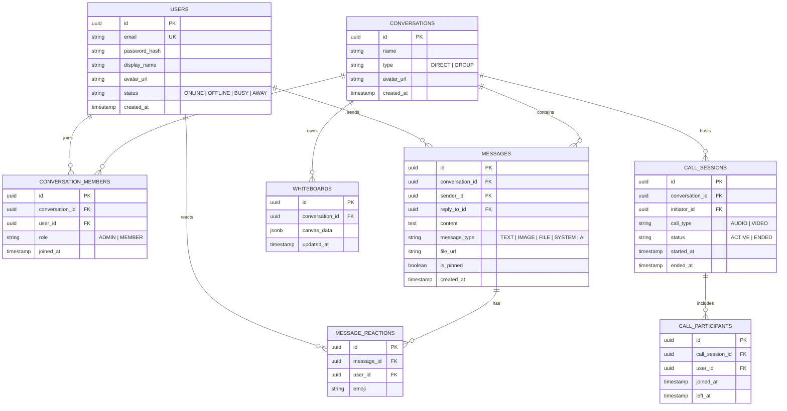

# KẾ HOẠCH PHÁT TRIỂN ỨNG DỤNG HỌP & NHẮN TIN TRỰC TUYẾN (TEAMS CLONE)
> **Tên dự án tham chiếu:** `promessagesapp` (Spring Boot Backend + Modern Web Frontend)  
> **Quy mô đội ngũ:** 3 thành viên  
> **Thời gian dự kiến:** 7 tuần (Chia đều theo Module chức năng & Fullstack cho cả 3 thành viên)  
> **Nguyên tắc phân chia:** Chia đều theo **chức năng nghiệp vụ (Feature-based / Vertical Slice)** — mỗi thành viên làm chủ một phân hệ chức năng từ Giao diện (Frontend) đến Xử lý nghiệp vụ & CSDL (Backend/DB), khối lượng tương đương nhau xuyên suốt từ Tuần 1 đến Tuần 7.

---

## 1. TỔNG QUAN DỰ ÁN & KIẾN TRÚC KỸ THUẬT

### 1.1 Mục tiêu dự án
Xây dựng nền tảng cộng tác và hội nghị trực tuyến thời gian thực chuẩn phong cách Microsoft Teams với 3 trụ cột nghiệp vụ lớn:
1. **Module 1: Quản trị Tài khoản & Hệ thống Nhắn tin Thời gian thực (Auth, Presence & Real-time Chat)**: Đăng ký/đăng nhập, trạng thái hoạt động, chat 1-1, chat nhóm/kênh, chia sẻ file, thông báo tức thì.
2. **Module 2: Hội nghị Âm thanh, Hình ảnh & Chia sẻ màn hình (Audio/Video Calling & Screen Share)**: Cuộc gọi thoại & hình ảnh chất lượng cao 1-1 và đa điểm (Mesh WebRTC), chia sẻ màn hình, cơ chế chuyển tiếp tín hiệu Signaling Server.
3. **Module 3: Bảng vẽ Tương tác Trực tuyến & Trợ lý Thông minh AI (Whiteboard & AI Assistant)**: Bảng vẽ nhiều người vẽ cùng lúc trong phòng họp, trợ lý AI tóm tắt nội dung hội thoại, trích xuất việc cần làm và trả lời thông minh qua LLM.

### 1.2 Kiến trúc Hệ thống

```
[ Frontend: React / Vite + TypeScript + Tailwind CSS ]
       │                      │                      │
       │ HTTP REST API        │ WebSocket STOMP      │ WebRTC P2P / Mesh
       ▼                      ▼                      ▼
┌─────────────────────────────────────────────────────────────┐
│              BACKEND: Spring Boot (promessagesapp)          │
│  ├── Module 1: Auth & User & Realtime Chat Service          │
│  ├── Module 2: WebRTC Signaling & Call Management Service   │
│  └── Module 3: Whiteboard Synchronization & AI Service      │
└─────────────────────────────────────────────────────────────┘
       │                      │                      │
       ▼                      ▼                      ▼
[ PostgreSQL / MySQL ]    [ Redis Presence ]    [ AI API / Coturn ]
```

---

## 2. PHÂN CHIA VAI TRÒ ĐỘI NGŨ THEO CHỨC NĂNG (3 THÀNH VIÊN)

| Thành viên | Trọng tâm Phân hệ Chức năng | Phạm vi công việc (Fullstack theo chức năng) |
| :--- | :--- | :--- |
| **Thành viên 1** | **Xác thực, Người dùng & Nhắn tin Thời gian thực (Auth & Realtime Chat Lead)** | - **Backend:** Spring Security + JWT, Quản lý User/Presence, WebSocket Chat Broker, Entity Message/Conversation, REST API Chat & File Upload.<br>- **Frontend:** Layout App Shell Teams, Giao diện Auth, Khung chat 1-1 và nhóm, Quản lý hội thoại/kênh, Typing indicator, Danh sách online/offline. |
| **Thành viên 2** | **Hội nghị Âm thanh, Hình ảnh & Họp trực tuyến (Audio/Video Calling & WebRTC Lead)** | - **Backend:** WebSocket Signaling Server (`/app/call/**`), Quản lý `CallSession`/`CallParticipant`, Lịch sử cuộc gọi (Call Logs), Cấu hình STUN/TURN.<br>- **Frontend & Media:** Module WebRTC Client (`RTCPeerConnection`), Giao diện phòng gọi thoại/video (Video Grid), Mute/Cam toggle, Chia sẻ màn hình (Screen Share), Phát hiện tiếng nói (VAD). |
| **Thành viên 3** | **Bảng vẽ Tương tác Trực tuyến & Trợ lý Trí tuệ Nhân tạo (Whiteboard & AI Lead)** | - **Backend:** WebSocket Whiteboard Broker (`/topic/whiteboard/**`), Lưu trữ nét vẽ/snapshot, Tích hợp Spring AI / Gemini API (Chatbot, Tóm tắt, Trích xuất việc cần làm).<br>- **Frontend:** Whiteboard Canvas Studio (Fabric.js), Đồng bộ nét vẽ & con trỏ chuột thời gian thực, Giao diện AI Assistant (@bot), Hiển thị tóm tắt cuộc họp & Smart Replies. |

---

## 3. LỘ TRÌNH 7 TUẦN CHI TIẾT (CHIA ĐỀU CHO 3 THÀNH VIÊN)

### TUẦN 1: KHỞI TẠO NỀN TẢNG & NỀN MÓNG CÁC PHÂN HỆ
*Mục tiêu tuần: Cả 3 thành viên dựng xong môi trường, cấu hình backend/frontend và xây dựng phần móng của module mình phụ trách.*

- **Thành viên 1 (Auth & Chat Core):**
  - **Backend:** Cấu hình `pom.xml` (Spring Data JPA, Spring Security, JWT, Validation, PostgreSQL Driver). Thiết kế entity `User`, `Role`. Viết API Đăng ký (`/api/auth/register`), Đăng nhập (`/api/auth/login`), Lấy thông tin cá nhân (`/api/auth/me`).
  - **Frontend:** Xây dựng trang Đăng nhập / Đăng ký đẹp mắt, validate form, lưu trữ token JWT vào LocalStorage / Cookie và kết nối API Auth.
- **Thành viên 2 (WebRTC Calling):**
  - **Backend:** Cấu hình Spring WebSocket STOMP Server (`/ws` endpoint). Thiết kế cơ chế bắt sự kiện kết nối/ngắt kết nối WebSocket (`SessionConnectedEvent`, `SessionDisconnectEvent`).
  - **Frontend & Media:** Tạo module kiểm tra và yêu cầu cấp quyền thiết bị Micro / Webcam từ trình duyệt (`navigator.mediaDevices.getUserMedia`). Viết PoC kết nối STOMP client từ Frontend để chuẩn bị cho Signaling.
- **Thành viên 3 (Whiteboard & AI):**
  - **Frontend:** Khởi tạo kiến trúc Frontend chuẩn (React + Vite + TypeScript + Tailwind CSS), dựng khung giao diện chính (App Shell Microsoft Teams: Activity bar, Sidebar, Main Content area, Header profile).
  - **Backend & AI:** Khảo sát và tích hợp Spring AI / HTTP Client tới Gemini/OpenAI API. Viết service cơ bản test gọi prompt thành công từ Backend (`/api/ai/health`). Chuẩn bị cấu trúc dữ liệu lưu trữ nét vẽ Canvas.

---

### TUẦN 2: CHAT 1-1, CUỘC GỌI THOẠI 1-1 & BẢNG VẼ ĐỘC LẬP
*Mục tiêu tuần: Hoàn thành tính năng nhắn tin 1-1 tức thì, thực hiện được cuộc gọi thoại P2P và vẽ canvas cơ bản.*

- **Thành viên 1 (Auth & Chat Core):**
  - **Backend:** Tạo entity `Conversation` (loại 1-1), `Message`. Viết API lấy lịch sử tin nhắn phân trang (`GET /api/conversations/{id}/messages`). Cấu hình STOMP message channel `/topic/chat/{conversationId}`.
  - **Frontend:** Khung chat 1-1: Hiển thị danh sách tin nhắn, ô nhập tin nhắn, gửi tin nhắn tức thì qua STOMP, hiển thị bong bóng chat theo người gửi.
- **Thành viên 2 (WebRTC Calling):**
  - **Backend:** Thiết kế giao thức Signaling qua STOMP: các message type `CALL_INVITE`, `CALL_ACCEPT`, `CALL_REJECT`, `CALL_OFFER`, `CALL_ANSWER`, `ICE_CANDIDATE`. Tạo entity `CallSession`.
  - **Frontend & Media:** Modal thông báo cuộc gọi đến (đổ chuông, nút Nhận / Từ chối). Tạo luồng `RTCPeerConnection` Audio-only kết nối P2P giữa 2 người dùng. Nút Mute/Unmute microphone.
- **Thành viên 3 (Whiteboard & AI):**
  - **Frontend:** Tích hợp Canvas Engine (HTML5 Canvas / Fabric.js), xây dựng thanh công cụ vẽ: Bút vẽ tự do, Tẩy, Chọn màu, Độ dày nét vẽ, Nút Xóa bảng (Clear).
  - **Backend:** Thiết kế entity `WhiteboardSession`. Tạo kênh WebSocket STOMP `/topic/whiteboard/{sessionId}` để phát lại các nét vẽ cơ bản cho các thành viên.

---

### TUẦN 3: CHAT NHÓM & MEDIA, CUỘC GỌI VIDEO 1-1 & ĐỒNG BỘ BẢNG VẼ
*Mục tiêu tuần: Chat nhóm gửi kèm hình ảnh/file, gọi video 1-1 mượt mà, nhiều người cùng vẽ trên một bảng.*

- **Thành viên 1 (Auth & Chat Core):**
  - **Backend:** Mở rộng entity `Conversation` (loại GROUP), `ConversationMember`. API tạo nhóm, thêm/xóa thành viên. API upload file/hình ảnh đính kèm (`/api/files/upload`).
  - **Frontend:** Modal tạo nhóm chat mới, giao diện danh sách thành viên nhóm. Chức năng tải ảnh/file đính kèm vào khung chat và render ảnh/link tải file trực tiếp.
- **Thành viên 2 (WebRTC Calling):**
  - **Backend:** Mở rộng Signaling Server hỗ trợ trao đổi video tracks, cập nhật trạng thái kết thúc cuộc gọi và tính thời lượng gọi.
  - **Frontend & Media:** Nâng cấp WebRTC client hỗ trợ Video stream (`audio: true`, `video: true`). Giao diện gọi video 1-1 (video đối phương toàn màn hình, video của mình ở góc nhỏ PiP). Nút Bật/Tắt Webcam và chọn thiết bị đầu vào.
- **Thành viên 3 (Whiteboard & AI):**
  - **Frontend:** Bổ sung công cụ hình học (Hình chữ nhật, Hình tròn, Đường thẳng, Mũi tên, Hộp văn bản Text box). Hiển thị con trỏ chuột thời gian thực kèm tên của các người vẽ khác trên Canvas.
  - **Backend:** Cơ chế gom cụm tọa độ nét vẽ (Throttling / Debouncing) trước khi gửi qua WebSocket để tránh nghẽn băng thông. API lưu snapshot bảng vẽ thành JSON vào DB.

---

### TUẦN 4: TRẢI NGHIỆM CHAT NÂNG CAO, HỘI NGHỊ NHÓM & BOT AI TRONG CHAT
*Mục tiêu tuần: Trạng thái typing/presence, gọi video nhóm đa người dùng, tích hợp chatbot AI hỏi đáp trực tiếp trong chat.*

- **Thành viên 1 (Auth & Chat Core):**
  - **Backend:** Cơ chế User Presence: Quản lý và broadcast trạng thái Online / Offline / Busy qua Redis hoặc In-memory. Kênh WebSocket thông báo "Ai đang soạn tin..." (Typing indicator).
  - **Frontend:** Hiển thị chấm trạng thái online trên avatar. Hiển thị dòng chữ động *"[Tên người dùng] đang nhập tin nhắn..."*. Trình tìm kiếm tin nhắn và danh bạ người dùng.
- **Thành viên 2 (WebRTC Calling):**
  - **Backend:** Quản lý phòng gọi nhóm đa người dùng: Quản lý danh sách `participants` trong phòng họp, tự động dọn dẹp phòng khi người cuối cùng thoát.
  - **Frontend & Media:** Xây dựng mô hình Mesh WebRTC cho phòng họp 3-5 người (mỗi client kết nối peer tới từng người khác). Giao diện Video Grid co giãn tự động theo số lượng người tham gia, phát hiện giọng nói (VAD) để đổi viền sáng quanh video người đang nói.
- **Thành viên 3 (Whiteboard & AI):**
  - **Backend:** Tích hợp Spring AI Service: Tạo endpoint `/api/ai/chat` (Server-Sent Events - SSE để stream câu trả lời từng chữ). Xây dựng System Prompt chuyên nghiệp cho trợ lý Teams.
  - **Frontend:** Tính năng triệu hồi bot AI trong nhóm chat (gõ `@AI-Assistant` hoặc nút Hỏi AI). Giao diện hiển thị tin nhắn AI gõ chữ mượt mà, hỗ trợ render Markdown và Code block.

---

### TUẦN 5: QUẢN LÝ TỆP & PIN, CHIA SẺ MÀN HÌNH & BẢNG VẼ TRONG PHÒNG HỌP
*Mục tiêu tuần: Ghim tin nhắn/tài liệu, chia sẻ màn hình trong cuộc gọi, nhúng bảng vẽ tương tác trực tiếp vào cuộc họp.*

- **Thành viên 1 (Auth & Chat Core):**
  - **Backend:** Tính năng Ghim tin nhắn (`PinnedMessages`), Đánh dấu tin nhắn quan trọng, Thư viện lưu trữ tất cả Media/Files đã gửi trong từng nhóm chat (`GET /api/conversations/{id}/media`).
  - **Frontend:** Tab "Tệp đã chia sẻ" và "Tin nhắn đã ghim" ở thanh bên phải khung chat. Xem trước (Preview) ảnh và file PDF trực tiếp trên ứng dụng.
- **Thành viên 2 (WebRTC Calling):**
  - **Backend:** Bổ sung cơ chế báo hiệu chia sẻ màn hình qua Signaling Server (loại track `SCREEN_SHARE`).
  - **Frontend & Media:** Tích hợp tính năng Chia sẻ toàn màn hình hoặc cửa sổ ứng dụng (`navigator.mediaDevices.getDisplayMedia`). Giao diện ưu tiên phóng to màn hình được chia sẻ, thu nhỏ camera người nói xuống góc dưới.
- **Thành viên 3 (Whiteboard & AI):**
  - **Frontend:** Chế độ mở Bảng vẽ ngay trong cuộc họp (Split-screen view: một nửa màn hình là Video người họp, một nửa là Canvas vẽ chung). Nút Xuất file bảng vẽ ra ảnh PNG / PDF.
  - **Backend & AI:** Xây dựng tính năng "Tóm tắt cuộc trò chuyện" (Chat Summarizer): API gom các tin nhắn gần nhất và yêu cầu AI trích xuất nội dung chính kèm các đầu việc cần làm (Action Items).

---

### TUẦN 6: TIN TỨC TƯƠNG TÁC, TINH CHỈNH ĐỘ TRỄ MẠNG & GỢI Ý TRẢ LỜI AI
*Mục tiêu tuần: Cảm xúc/Emoji reaction cho tin nhắn, nâng cấp độ ổn định cuộc gọi, gợi ý trả lời thông minh (Smart Replies).*

- **Thành viên 1 (Auth & Chat Core):**
  - **Backend:** Thả cảm xúc trên tin nhắn (`MessageReaction` - Thích, Thả tim, Haha, Cười...), Trả lời trích dẫn tin nhắn cũ (Reply/Quote message).
  - **Frontend:** Thanh chọn Emoji phản ứng nhanh khi rê chuột vào tin nhắn. Giao diện hiển thị tin nhắn trích dẫn kèm nút cuộn nhanh tới tin nhắn gốc.
- **Thành viên 2 (WebRTC Calling):**
  - **Backend:** Cài đặt cấu hình Coturn Server (STUN/TURN) để vượt tường lửa NAT trong môi trường mạng thực tế. Bổ sung bảng ghi lịch sử cuộc gọi (`CallLogs`: thời lượng, trạng thái nhỡ/thành công).
  - **Frontend & Media:** Xử lý cơ chế tự động kết nối lại khi mất mạng (ICE restart / Auto-reconnect). Giảm băng thông video khi mạng yếu để đảm bảo đường truyền thoại không bị gián đoạn.
- **Thành viên 3 (Whiteboard & AI):**
  - **Backend & AI:** Xây dựng tính năng AI Smart Replies: Tự động phân tích tin nhắn mới nhất và tạo 3 gợi ý trả lời nhanh cho người dùng. Thiết lập Rate Limiting và bảo vệ API Key AI.
  - **Frontend:** Hiển thị 3 nút gợi ý trả lời nhanh dạng pill phía trên ô nhập liệu. Nút "Tóm tắt nội dung cuộc họp" trong modal biên bản cuộc họp.

---

### TUẦN 7: KIỂM THỬ TOÀN DIỆN, DOCKER HÓA, BẢO MẬT & BÁO CÁO TỔNG KẾT
*Mục tiêu tuần: Đóng gói toàn bộ hệ thống bằng Docker, bảo mật HTTPS/WSS, kiểm thử tích hợp chéo và hoàn thiện báo cáo.*

- **Thành viên 1 (Auth & Chat Core):**
  - Hoàn thiện UI/UX toàn hệ thống: Tinh chỉnh giao diện Dark/Light mode chuẩn Teams, tối ưu Responsive trên màn hình Tablet/Laptop nhỏ.
  - Viết Unit Test & Integration Test cho tầng Auth, UserController, MessageController. Kiểm thử tải đồng thời 50-100 kết nối WebSocket chat.
- **Thành viên 2 (WebRTC Calling):**
  - Viết `Dockerfile` cho Backend Spring Boot và Frontend React. Tạo `docker-compose.yml` tích hợp Spring Boot, PostgreSQL, Redis và Coturn Server.
  - Cấu hình SSL/TLS (HTTPS và WSS) bắt buộc để trình duyệt cấp quyền truy cập Camera/Microphone trên môi trường mạng LAN/Internet. Kiểm thử cuộc gọi video 3-4 người.
- **Thành viên 3 (Whiteboard & AI):**
  - Kiểm thử End-to-End (E2E Test) kịch bản kết hợp: Vừa họp video vừa vẽ bảng vẽ vừa nhờ AI tóm tắt nội dung.
  - Soạn thảo tài liệu hướng dẫn cài đặt và vận hành hệ thống (`README.md`, Swagger API Documentation). Chuẩn bị Slide thuyết trình báo cáo và video demo sản phẩm hoàn chỉnh.
- **Cả 3 thành viên:**
  - Tổng duyệt sản phẩm (UAT), rà soát lỗi chéo (Cross-testing) và chốt phiên bản Release cuối cùng.

---

## 4. MA TRẬN PHÂN CHIA CÔNG VIỆC THEO TUẦN (WORK BREAKDOWN MATRIX)

| Tuần | Thành viên 1<br>*(Auth, Users & Realtime Chat)* | Thành viên 2<br>*(WebRTC Calling & Media)* | Thành viên 3<br>*(Whiteboard & AI Assistant)* |
| :---: | :--- | :--- | :--- |
| **Tuần 1** | Setup Spring Security + JWT, Entity User, API Auth, UI Login/Register | Setup Spring WebSocket STOMP, Event Listener, Xin quyền Mic/Cam, PoC STOMP Client | Dựng App Shell Teams (Sidebar/Layout), Cấu hình Spring AI / Gemini API Health Check |
| **Tuần 2** | Entity Conversation/Message, API Chat History, STOMP Chat, UI Chat 1-1 | Thiết kế Signaling STOMP, Entity CallSession, Modal nhận cuộc gọi, Audio Call P2P | Canvas Studio (Bút, Tẩy, Màu), Kênh STOMP nét vẽ, Entity WhiteboardSession |
| **Tuần 3** | Chat Nhóm, Quản lý thành viên nhóm, Upload & Gửi ảnh/file qua chat | Video Call 1-1 P2P, PiP Video UI, Nút Bật/Tắt Webcam & Micro, Device selector | Công cụ hình học/Text, Đồng bộ nét vẽ mượt mà (throttle), Con trỏ chuột đa người dùng |
| **Tuần 4** | User Presence (Online/Offline/Busy), Typing indicator, Tìm kiếm tin nhắn | Group Video Call (Mesh 3-5 người), Grid video tự co giãn, Nhận diện giọng nói VAD | Spring AI SSE Streaming API, Tích hợp bot `@AI-Assistant` vào chat, Render Markdown/Code |
| **Tuần 5** | Ghim tin nhắn quan trọng, Thư viện lưu trữ File/Media của nhóm chat | Tính năng Chia sẻ màn hình (`getDisplayMedia`), Layout ưu tiên màn hình chia sẻ | Tích hợp Whiteboard vào phòng họp (Split-screen), AI Tóm tắt đoạn chat (Summarizer) |
| **Tuần 6** | Reaction Emoji trên tin nhắn, Quote/Reply tin nhắn cũ, Phân trang tin nhắn | Cấu hình Coturn (STUN/TURN), Xử lý rớt mạng/Auto-reconnect, Entity CallLogs | AI Smart Replies (3 gợi ý trả lời nhanh), Biên bản cuộc họp tự động, Rate limit AI |
| **Tuần 7** | Tối ưu UI/UX Dark/Light mode, Responsive, Viết Test Auth & Chat Controller | Viết Dockerfile, Docker Compose (App + DB + Coturn), Cấu hình HTTPS & WSS | Test E2E kết hợp (Gọi + Vẽ + AI), Viết README, API Doc, Chuẩn bị Slide & Video Demo |

---

## 5. THIẾT KẾ CƠ SỞ DỮ LIỆU CỐT LÕI (DATABASE SCHEMA)



---

## 6. QUY TRÌNH PHỐI HỢP VÀ QUẢN LÝ CODE (GIT WORKFLOW)

1. **Nhánh chính (Branches):**
   - `main`: Nhánh production, luôn ở trạng thái ổn định và chạy được.
   - `develop`: Nhánh tích hợp cho từng tuần.
   - `feature/w[tuần]-[thành-viên]-[tên-tính-năng]`: Ví dụ `feature/w1-tv1-auth-jwt`, `feature/w1-tv2-webrtc-signaling`, `feature/w1-tv3-teams-layout`.
2. **Quy định Pull Request (PR):**
   - Không push trực tiếp vào `main` hoặc `develop`.
   - Mỗi PR phải được ít nhất 1 thành viên khác review và phê duyệt trước khi merge.
   - Đảm bảo mã nguồn biên dịch thành công (`./mvnw clean compile` và `npm run build`).
3. **Quy trình họp và theo dõi:**
   - **Daily Standup (10-15 phút):** Mỗi thành viên chia sẻ: *Hôm qua đã xong gì? Hôm nay làm gì? Có vướng mắc/blocker gì cần hỗ trợ không?*
   - **Sprint Demo (Cuối mỗi tuần):** Cả 3 người cùng tích hợp nhánh vào `develop`, chạy thử luồng liên thông và đánh giá tiến độ.
